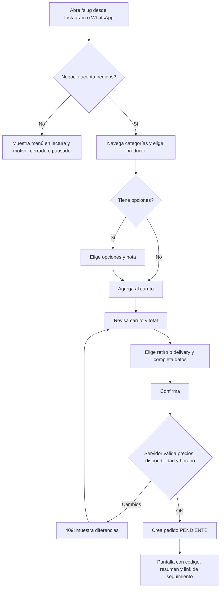
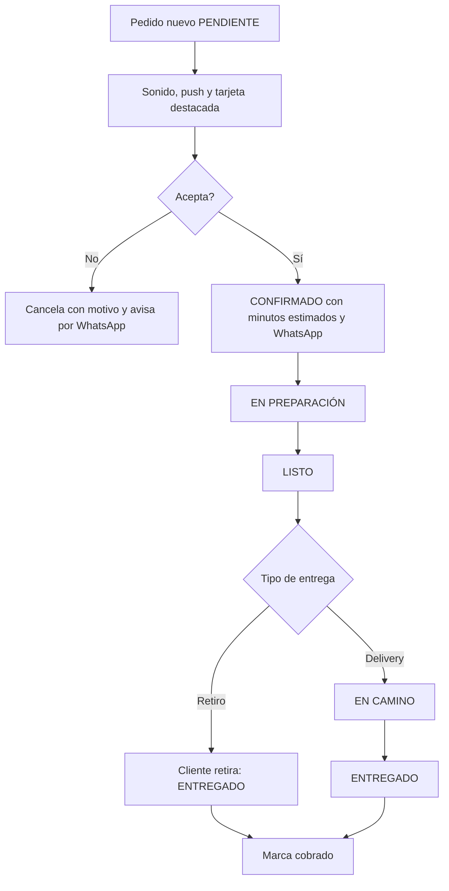
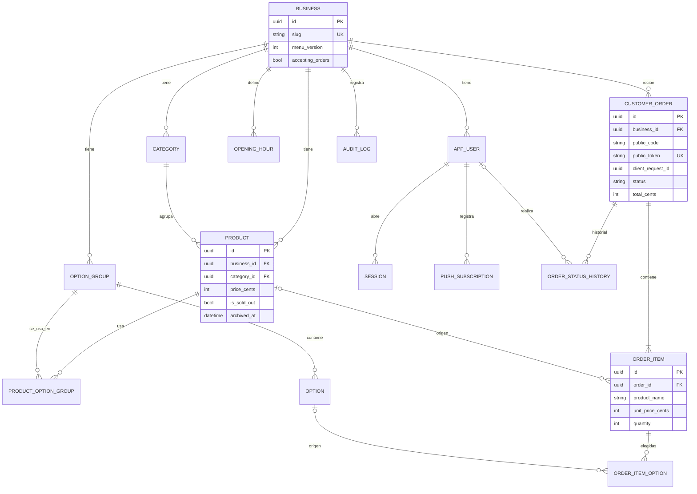
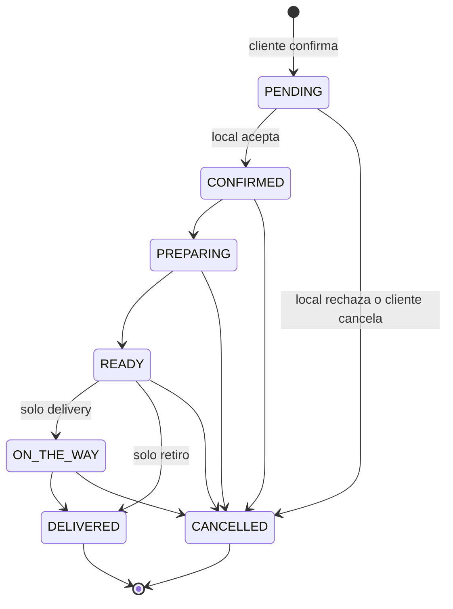

# Planificación integral: sistema de pedidos para casas de comida

22/10/2026

Plan técnico y funcional, sin código, de una plataforma multi-negocio de menú digital, pedidos y panel para casas de comida de barrio. Termina con 10 decisiones, cada una con dos opciones, que hay que aprobar antes de la primera fase.

## 1. Resumen ejecutivo

Se propone **una plataforma multi-negocio** (una base de datos, una aplicación, cada casa de comidas identificada por un `slug`) construida como **monolito modular en Next.js 16**, con el mismo stack que ya usás en Agendapp (Next.js 16.4, Prisma 7, PostgreSQL en Neon, Vercel, Tailwind 4). Reutilizar el stack evita aprender herramientas nuevas y permite reaprovechar lo ya resuelto: sesiones, push con web-push, tests con Vitest y Playwright, y las trampas documentadas en tus notas de Next.js 16 y Prisma 7.

| Tema | Decisión propuesta | Alternativa descartada |
| --- | --- | --- |
| Arquitectura | Monolito modular Next.js (App Router) con rutas REST en `/api/v1` | Front y back separados; BaaS (Supabase/Firebase) |
| Multi-negocio | Multi-tenant lógico desde el MVP: columna `business_id` en cada tabla del negocio | Una instalación por cliente |
| Base de datos | PostgreSQL en Neon, dinero en enteros (centavos) | Base por cliente |
| Tiempo real | Consulta periódica (polling) cada 5 s + notificación push y sonido | WebSockets/SSE propios (no encajan con funciones serverless) |
| WhatsApp | Enlaces `wa.me` con mensaje precompletado | API oficial (cuesta por mensaje y exige verificación de Meta) |
| Pagos | Efectivo y transferencia, registro manual de "cobrado" | Pasarela online en el MVP |
| Fotos | Vercel Blob, WebP de hasta 1600 px | Cloudflare R2 (queda como alternativa) |
| Hosting | Vercel Pro, región `gru1` (el plan Hobby no permite uso comercial) | Railway |

**Números clave**

- Esfuerzo estimado del MVP: **\~250 horas** (≈ 12–13 semanas a 20 h semanales, con asistencia de Claude Code). Detalle y supuestos en la sección 21.
- Costo fijo de plataforma: **\~USD 30 a 40 por mes**, compartido por todos los negocios (Vercel Pro USD 20 más Neon entre USD 10 y 20 en producción, más el dominio). Con un abono de USD 25 por negocio, **2 negocios** cubren ese costo.
- Riesgo principal de producto: que el local no vea un pedido nuevo. Se mitiga con sonido, push, indicador visual y recordatorio de pedidos pendientes (sección 24).
- Riesgo principal técnico: que un negocio vea datos de otro. Se mitiga con una capa de acceso a datos que exige `business_id`, claves foráneas compuestas y tests de aislamiento (secciones 14, 17 y 19).

**Lo que este documento no hizo:** no se relevaron locales reales ni la competencia. La Fase 0 existe para eso, y varias decisiones de la sección 26 dependen de lo que diga el primer local piloto.

## 2. Visión del producto y propuesta de valor

**Problema.** Una casa de comidas de barrio recibe pedidos por WhatsApp o teléfono. Cada pedido llega como texto libre, hay que preguntar nombre, dirección y forma de pago, se pierden mensajes en horas pico y alguien tiene que estar atento todo el tiempo.

**Producto.** Un link (`/{slug}`) donde el cliente ve el menú, arma el pedido y lo envía en un formato fijo. El local lo recibe en un panel con sonido y notificación, cambia el estado con un toque y avisa al cliente por WhatsApp con un mensaje ya escrito.

| Para quién | Qué cambia |
| --- | --- |
| Cliente | Ve precios y fotos, personaliza sin escribir, sabe el total antes de pedir y recibe un código de pedido |
| Dueño o encargado | Pedidos con todos los datos en el mismo formato, estados claros, menos errores de transcripción, números del negocio |
| Vos (quien vende el sistema) | Un solo producto para varios negocios, con abono mensual y un único despliegue |

**Metas medibles del MVP** (se validan en la prueba piloto):

- Un cliente nuevo completa un pedido de 2 productos en menos de **90 segundos** desde el celular.
- Un pedido nuevo aparece en el panel abierto en **10 segundos o menos**.
- El local cambia un pedido de estado en **un toque** desde la lista.
- Cero pedidos con total distinto al calculado por el servidor.

**Qué no se afirma:** que el sistema aumente las ventas. Eso se mide en el piloto comparando pedidos por semana antes y después, si el local tiene registro de lo anterior.

Pendiente para Fase 0: relevar alternativas que el local ya podría estar usando (menús con botón de WhatsApp, apps de delivery con comisión) y comparar contra esta propuesta. No se investigaron en este documento.

## 3. Alcance del MVP

El MVP está terminado cuando **un local real operó un día completo de servicio** con pedidos reales, sin usar WhatsApp para recibir pedidos nuevos (solo para avisar estados).

| Módulo | Incluye |
| --- | --- |
| Menú público | Página `/{slug}`, categorías, productos con foto y precio, agotado/oculto, estado abierto/cerrado/pausado |
| Personalización | Grupos de opciones (mínimo/máximo, precio extra), ingredientes quitables, nota por ítem |
| Carrito y checkout | Cantidades, edición, totales, retiro o delivery, datos mínimos, efectivo o transferencia |
| Pedido | Código corto, token de seguimiento público, estados, cancelación con motivo, hora estimada |
| Panel | Login, lista de pedidos activos agrupada por estado, detalle, cambio de estado, búsqueda, historial, sonido y push |
| WhatsApp | Botón con mensaje precompletado según el estado |
| Administración | CRUD de categorías y productos, grupos de opciones, agotado en un toque, horarios, pausa, datos del negocio, costo de envío y pedido mínimo |
| Usuarios | Dueño, encargado y personal con permisos distintos |
| Métricas | Pedidos por período, estados, ventas completadas, ticket promedio, productos más pedidos, horas pico, retiro vs. delivery |
| Seguridad | Controles de la sección 17 marcados como "MVP" |
| Operación | Auditoría de acciones administrativas, backups, monitoreo básico |

La clasificación de cada funcionalidad adicional (MVP, segunda versión, avanzada) está en la sección 25.

## 4. Funcionalidades excluidas del MVP

- Pagos online (Mercado Pago u otra pasarela) y conciliación de cobros.
- Envío automático de mensajes por la API oficial de WhatsApp.
- Cuentas de clientes, historial de pedidos del cliente y programa de puntos.
- Zonas de reparto por barrio con tarifas distintas (el MVP usa un costo de envío fijo).
- Promociones, cupones y descuentos.
- Pedidos programados para otro día u hora.
- Control de stock por cantidad (el MVP solo tiene "agotado" sí/no).
- Panel de superadministrador, planes y cobro de suscripciones (el abono se cobra por fuera, a mano).
- Dominio propio por negocio (el MVP usa `/{slug}` en un dominio común).
- Seguimiento de repartidores, mapas y cálculo de rutas.
- Impresión automática en impresora térmica (el MVP solo ofrece pantalla imprimible, y solo en la segunda versión).
- Exportación de reportes, facturación electrónica y contabilidad.
- Modo sin conexión con cola de acciones (el panel avisa que no hay conexión y bloquea cambios).
- Aplicación nativa en tiendas (el panel es una PWA instalable).

## 5. Actores, roles y permisos

**Actores:** cliente (anónimo, sin cuenta), personal del local, encargado, dueño y, en una segunda versión, superadministrador de la plataforma (vos). Sistemas externos: WhatsApp (solo como destino de enlaces), servicio de push del navegador, almacenamiento de imágenes.

**Regla general:** el rol y el negocio salen siempre de la sesión en el servidor, nunca de datos enviados por el navegador.

| Acción | Cliente | Personal | Encargado | Dueño | Superadmin (v2) |
| --- | --- | --- | --- | --- | --- |
| Ver menú público y crear pedido | Sí | — | — | — | — |
| Ver su pedido con el token de seguimiento | Sí | — | — | — | — |
| Ver pedidos activos e historial del negocio | — | Sí | Sí | Sí | Solo soporte |
| Cambiar estado (confirmar, preparar, listo, en camino, entregado) | — | Sí | Sí | Sí | — |
| Cancelar o rechazar un pedido | — | Sí (con motivo) | Sí | Sí | — |
| Marcar pedido como cobrado | — | Sí | Sí | Sí | — |
| Marcar producto agotado/disponible | — | Sí | Sí | Sí | — |
| Crear, editar y archivar productos, categorías y opciones | — | — | Sí | Sí | — |
| Cambiar precios | — | — | Sí | Sí | — |
| Pausar pedidos y editar horarios | — | Sí (solo pausar) | Sí | Sí | — |
| Configurar envío, pedido mínimo y medios de pago | — | — | — | Sí | — |
| Ver métricas | — | — | Sí | Sí | Agregadas |
| Ver historial administrativo (auditoría) | — | — | — | Sí | Sí |
| Crear, desactivar usuarios y cambiar roles | — | — | — | Sí | Sí |
| Crear, suspender negocios y planes | — | — | — | — | Sí |

**Decisión de modelado:** en el MVP cada usuario pertenece a un solo negocio (`user.business_id` y `user.role`). Si más adelante un dueño tiene varios locales, se pasa a una tabla de membresías con una migración; no hace falta construirla ahora.

## 6. Requisitos funcionales y no funcionales

**Objetivo general.** Que una casa de comidas reciba y gestione pedidos propios desde un link, sin depender de mensajes de texto libre.

**Objetivos específicos.** (1) Menú configurable por el negocio. (2) Pedido con total calculado y validado en servidor. (3) Panel que muestre pedidos nuevos sin recargar. (4) Aviso al cliente por WhatsApp con un toque. (5) Métricas simples. (6) Producto vendible a varios negocios sin duplicar código.

Prioridad: **M** = MVP, **V2** = segunda versión.

### Requisitos funcionales

| Código | Requisito | Prio. |
| --- | --- | --- |
| RF-001 | Página pública `/{slug}` con nombre, logo, horario y estado (abierto, cerrado, pausado) | M |
| RF-002 | Listar categorías y productos activos mostrando solo los campos que el negocio habilitó (nombre, descripción, foto, precio, etiquetas) | M |
| RF-003 | Producto agotado visible pero no agregable; producto archivado no visible | M |
| RF-004 | Producto con grupos de opciones: mínimo, máximo, precio adicional, disponibilidad por opción | M |
| RF-005 | Ingredientes quitables y nota libre por ítem (máx. 200 caracteres) | M |
| RF-006 | Carrito: agregar, cambiar cantidad (1 a 20), editar opciones, quitar; subtotal por ítem y total | M |
| RF-007 | El carrito se conserva en el dispositivo y registra la versión del menú con que se armó | M |
| RF-008 | Al confirmar, el servidor recalcula todo; si hay diferencias responde 409 con el detalle y el cliente debe aceptar los cambios | M |
| RF-009 | Elegir retiro o delivery antes de confirmar | M |
| RF-010 | Datos de retiro: nombre y celular. Delivery: además calle, número, barrio, piso/depto y referencias | M |
| RF-011 | Validar celular argentino y normalizarlo (formato E.164) | M |
| RF-012 | Mostrar costo de envío y pedido mínimo antes de confirmar; delivery activable y desactivable | M |
| RF-013 | Medio de pago: efectivo (con campo "pago con") o transferencia (muestra alias), según configuración | M |
| RF-014 | Enviar el pedido dos veces (doble toque, reintento) no crea dos pedidos | M |
| RF-015 | Al confirmar generar ID interno, código corto, token público, fecha y hora, estado PENDIENTE | M |
| RF-016 | Pantalla de confirmación con código, resumen y aviso "pendiente de confirmación del local" | M |
| RF-017 | Seguimiento público del estado mediante el token, sin exponer datos personales de otros | M |
| RF-018 | Estados y transiciones según tipo de entrega y rol (sección 16) | M |
| RF-019 | Cancelar o rechazar con motivo obligatorio, registrado con usuario y hora | M |
| RF-020 | El local puede indicar minutos estimados al confirmar; el cliente los ve | M |
| RF-021 | Login con email y contraseña, cierre de sesión, cambio de contraseña | M |
| RF-022 | Lista de pedidos activos agrupada por estado, los más antiguos primero | M |
| RF-023 | Actualización automática del panel, sonido, indicador de nuevos y notificación push | M |
| RF-024 | Detalle de pedido con cliente, entrega, ítems, opciones, notas, importes e historial de estados | M |
| RF-025 | Cambiar estado con un toque desde la tarjeta del pedido | M |
| RF-026 | Buscar por código, nombre o teléfono; filtrar por estado y fecha; historial paginado | M |
| RF-027 | Botón de WhatsApp con mensaje precompletado según estado | M |
| RF-028 | Marcar pedido como cobrado (fecha y usuario) | M |
| RF-029 | Resumen del día en la pantalla principal | M |
| RF-030 | Crear, editar, ordenar y archivar categorías | M |
| RF-031 | Crear, editar y archivar productos: nombre, descripción, precio, foto, etiquetas | M |
| RF-032 | Activar/desactivar y marcar agotado un producto en un toque | M |
| RF-033 | Grupos de opciones reutilizables entre productos | M |
| RF-034 | Horarios semanales, pausa manual de pedidos y mensaje de cierre | M |
| RF-035 | Configurar logo, color principal, WhatsApp del local, medios de pago, envío y pedido mínimo | M |
| RF-036 | Historial administrativo visible para el dueño | M |
| RF-037 | El dueño crea, desactiva usuarios y asigna rol | M |
| RF-038 | Métricas definidas en la sección 7 | M |
| RF-039 | Exportar pedidos a CSV | V2 |
| RF-040 | Zonas de reparto con tarifa por barrio | V2 |
| RF-041 | Ticket imprimible (80 mm) | V2 |
| RF-042 | Panel de superadministrador | V2 |

### Requisitos no funcionales

| Código | Requisito | Medición |
| --- | --- | --- |
| RNF-001 | Rendimiento del menú en celular de gama baja | LCP ≤ 2,5 s en Lighthouse "Slow 4G"; JS de la ruta ≤ 200 KB gzip |
| RNF-002 | Creación de pedido | p95 ≤ 800 ms en servidor |
| RNF-003 | Visibilidad de pedidos nuevos en el panel | ≤ 10 s desde la creación |
| RNF-004 | Disponibilidad objetivo | 99,5 % mensual (≈ 3,6 h de caída); depende de proveedores, sin SLA propio |
| RNF-005 | Mobile first | Revisión a 360 px; objetivos táctiles ≥ 44 px; campos a 16 px; sin scroll horizontal |
| RNF-006 | Accesibilidad | Contraste ≥ 4,5:1; WCAG 2.2 nivel AA en flujos críticos |
| RNF-007 | Transporte | Solo HTTPS; HSTS |
| RNF-008 | Contraseñas | Argon2id; mínimo 10 caracteres |
| RNF-009 | Aislamiento entre negocios | Suite de tests automatizados que intenta cruzar datos y debe fallar siempre |
| RNF-010 | Recuperación | RPO ≤ 24 h (copia externa) y RTO ≤ 4 h |
| RNF-011 | Registros | Logs estructurados sin datos personales completos (teléfono enmascarado) |
| RNF-012 | Imágenes | WebP, lado mayor ≤ 1600 px, subida ≤ 5 MB, peso servido ≤ 200 KB |
| RNF-013 | Calidad | 100 % de cobertura en cálculo de precios y máquina de estados; 5 flujos e2e |
| RNF-014 | Localización | Español (es-AR), ARS, zona horaria America/Argentina/Buenos\_Aires |
| RNF-015 | Datos personales | Solo los necesarios; retención identificable de 12 meses (sección 17) |

### Restricciones, supuestos y preguntas abiertas

**Restricciones:** una sola persona desarrollando (\~20 h semanales); presupuesto de infraestructura bajo; Vercel Hobby no permite uso comercial; no hay pasarela de pago.

| Supuesto a validar | Impacto si es falso |
| --- | --- |
| El local tiene un celular o tablet con conexión estable donde dejar el panel abierto | Habría que priorizar un mecanismo de aviso por WhatsApp o impresión |
| El local acepta cambiar de "pedido por mensaje" a "pedido por link" | Sin adopción no hay datos; se necesita un piloto con acompañamiento |
| La mayoría de los clientes tiene WhatsApp | El aviso de estado no llegaría; se mostraría solo en el seguimiento |
| Un costo de envío fijo alcanza | Si no, hay que adelantar RF-040 (zonas) |
| El menú de un local tiene menos de \~150 productos | Si no, hay que paginar o buscar en el menú público |

**Preguntas para el local piloto (Fase 0):** ¿cuántos pedidos por día y por hora pico?; ¿quién atiende el celular?; ¿cobran por transferencia?; ¿hacen delivery propio y hasta dónde?; ¿cuántos productos tienen opciones o extras?; ¿hay productos que se agotan durante el día?; ¿qué datos del cliente piden hoy?

**Contradicciones detectadas en el pedido original y cómo se resolvieron:**

- "Costos de envío, zonas y pedido mínimo" aparecen como evaluación. Se resolvió con envío fijo y mínimo en el MVP y zonas en V2.
- "Seguimiento del pedido" y "código que no permita acceder a pedidos ajenos" chocan si el código corto es la credencial. Se separan: el código corto sirve para hablar con el local; el acceso público usa un token largo e impredecible.
- "No presuponer aceptación automática" y "velocidad": se deja la confirmación manual por defecto y una opción por negocio para confirmar automáticamente (decisión D8 en la sección 26).

## 7. Reglas de negocio

### Precios y pedido

- **RN-01** Todos los importes se guardan como enteros en centavos (ARS). Nunca se usan números decimales de punto flotante.
- **RN-02** Precio de una línea = cantidad × (precio base del producto + suma de los adicionales de las opciones elegidas). Total = suma de líneas + costo de envío (solo delivery).
- **RN-03** El servidor calcula todos los importes a partir de la base de datos. Del navegador solo toma IDs de producto, IDs de opción, cantidades y notas; cualquier precio recibido se ignora.
- **RN-04** Cada grupo de opciones valida `min` y `max` de selecciones; un grupo obligatorio tiene `min` ≥ 1. Una opción no disponible no se puede elegir.
- **RN-05** Un producto agotado, archivado o de otra categoría inactiva no se puede pedir. Si estaba en el carrito, el servidor responde 409 con la lista de ítems afectados.
- **RN-06** Si el precio cambió desde que el cliente armó el carrito, el servidor responde 409 con precio anterior y nuevo; el pedido se crea solo después de que el cliente acepta.
- **RN-07** Cantidad por ítem entre 1 y 20; ítems distintos por pedido hasta 30; nota por ítem hasta 200 caracteres; nota del pedido hasta 300.
- **RN-08** Pedido mínimo: se compara contra el subtotal de productos (sin envío). Si no se alcanza, no se puede confirmar.
- **RN-09** Delivery solo si está activo en el negocio. Retiro siempre disponible mientras el negocio acepte pedidos.
- **RN-10** El negocio acepta pedidos si: no está pausado manualmente, la hora actual (zona Buenos Aires) está dentro del horario del día, y el último pedido no excede el horario de cierre.

### Pedido ya creado

- **RN-11** El pedido guarda copia de nombres, precios, opciones y costo de envío vigentes al momento de crearse. Cambiar el menú no modifica pedidos anteriores.
- **RN-12** El pedido no se edita después de creado. Si hay un error, se cancela con motivo y el cliente hace otro.
- **RN-13** Solo se pasa de un estado a otro por las transiciones de la sección 16. Cada cambio guarda usuario, hora y estado anterior.
- **RN-14** Cancelar exige motivo (lista fija más texto opcional). Un pedido ENTREGADO o CANCELADO no cambia más.
- **RN-15** El código corto (4 caracteres) no se repite entre pedidos del mismo negocio dentro del mismo día. El token público (128 bits aleatorios) es la única credencial de seguimiento.
- **RN-16** Un pedido PENDIENTE sin respuesta durante 15 minutos (valor configurable) se marca como "demorado" en el panel y reenvía la alerta. No se cancela solo.
- **RN-17** Un mismo celular no puede crear más de 5 pedidos por hora en un negocio ni más de 2 pendientes a la vez; superado el límite se informa y no se crea.

### Menú y usuarios

- **RN-18** Borrar un producto con pedidos asociados significa archivarlo. Los pedidos conservan su copia.
- **RN-19** Todo cambio administrativo (precios, productos, configuración, usuarios, cancelaciones) queda en el historial con usuario, fecha, entidad y valores anterior/nuevo.
- **RN-20** Un negocio siempre conserva al menos un usuario dueño activo.

### Definición de métricas

Todas las métricas usan la zona horaria America/Argentina/Buenos\_Aires y asignan cada pedido al día de su **fecha de creación**, con su **estado actual**. Así un pedido se cuenta una sola vez y siempre se cumple: recibidos = entregados + cancelados + activos.

| Métrica | Cálculo | Pedidos incluidos |
| --- | --- | --- |
| Pedidos recibidos | Cantidad de pedidos creados en el período | Todos |
| Pedidos entregados | Cantidad con estado ENTREGADO | Los creados en el período |
| Pedidos cancelados | Cantidad con estado CANCELADO | Los creados en el período |
| Importe de pedidos (bruto registrado) | Suma de `total` | No cancelados |
| Ventas completadas | Suma de `total` | ENTREGADO |
| Importe cancelado | Suma de `total` | CANCELADO |
| Cobrado | Suma de `total` | Con `paid_at` cargado y no cancelados |
| Ticket promedio | Ventas completadas ÷ pedidos entregados | ENTREGADO; vacío si no hay |
| Productos más pedidos | Suma de cantidades por producto (nombre guardado en el pedido) | No cancelados; excluye envío |
| Categorías más populares | Suma de cantidades por categoría guardada en el ítem | No cancelados |
| Retiro vs. delivery | Cantidad y porcentaje por tipo de entrega | No cancelados |
| Horas de mayor demanda | Pedidos por hora local de creación (0–23) | No cancelados |
| Tiempo de preparación | Mediana de (hora de LISTO − hora de CONFIRMADO) | ENTREGADO; solo se muestra con 10 o más pedidos |
| Distribución de estados | Cantidad por estado actual | Todos |

**Ganancia:** no se calcula ni se muestra, porque el sistema no tiene costos. Las pantallas dicen "ventas" o "importe", nunca "ganancia" ni "ingresos netos".

## 8. Flujos principales del sistema

### Cliente: del menú al pedido



### Local: del pedido a la entrega



### Otros flujos

- **Seguimiento:** el cliente abre el link con token, ve estado y minutos estimados, y se refresca cada 15 s mientras la pestaña está visible.
- **Cambio de menú:** el encargado marca "agotado" en la lista de productos; el menú público se invalida por etiqueta de caché y se actualiza de inmediato; el servidor igualmente valida al confirmar.
- **Pausa de emergencia:** un toque en el encabezado del panel pausa pedidos nuevos y muestra un mensaje configurable al cliente.

## 9. Mapa de navegación y pantallas

### Cliente (sin cuenta)

| Pantalla | Ruta | Propósito | Componentes clave | Estados vacíos y errores |
| --- | --- | --- | --- | --- |
| Menú | `/{slug}` | Ver productos y empezar el pedido | Encabezado con estado abierto/cerrado, barra de categorías fija, tarjetas de producto, barra inferior con carrito y total | Sin productos: "El menú se está cargando". Cerrado: menú en lectura con horario de apertura |
| Producto | Hoja inferior (bottom sheet) sobre el menú | Elegir cantidad, opciones y nota | Grupos de opciones con contador "elegir 1" o "hasta 3", total en vivo, botón "Agregar" | Opción obligatoria sin elegir: botón desactivado y mensaje bajo el grupo |
| Carrito | `/{slug}/carrito` | Revisar y editar | Lista de ítems, cantidades, subtotal por ítem, total | Vacío: botón "Ver menú". Ítem no disponible: marcado en rojo y bloquea avanzar |
| Datos del pedido | `/{slug}/confirmar` | Elegir entrega, completar datos y pago | Selector retiro/delivery, formulario corto, resumen con envío y total | Error por campo, con el texto junto al campo; mínimo no alcanzado con faltante en pesos |
| Confirmación | `/{slug}/pedido/{token}` | Mostrar código y estado | Código grande, estado, minutos estimados, resumen, aviso de que debe confirmar el local | Token inválido: "No encontramos este pedido" (sin distinguir si existe) |
| Cambios detectados | Diálogo sobre confirmar | Mostrar diferencias de precio o disponibilidad | Lista antes/después, botones "Aceptar cambios" y "Volver al carrito" | — |

### Panel del negocio

| Pantalla | Ruta | Propósito | Componentes clave | Estados vacíos y errores |
| --- | --- | --- | --- | --- |
| Ingreso | `/admin/ingresar` | Login | Email, contraseña | Mensaje genérico "Datos incorrectos" |
| Pedidos | `/admin` | Operación diaria | Encabezado con interruptor "Aceptando pedidos", contadores por estado, tarjetas agrupadas, indicador de conexión, resumen del día | Sin pedidos: "Todavía no hay pedidos hoy". Sin conexión: franja amarilla con hora de la última actualización |
| Detalle de pedido | Panel lateral o pantalla completa en celular | Ver todo y actuar | Datos del cliente, entrega, ítems, notas resaltadas, importes, historial, botones de estado y WhatsApp | Conflicto de estado: "Otro usuario ya cambió este pedido" y se recarga |
| Historial | `/admin/historial` | Buscar pedidos anteriores | Buscador (código, nombre, teléfono), filtros de estado y fecha, lista paginada | Sin resultados: sugiere limpiar filtros |
| Menú | `/admin/menu` | Editar productos y categorías | Lista por categoría con interruptores "visible" y "agotado", arrastrar para ordenar | Sin productos: asistente "Cargar primer producto" |
| Producto | `/admin/menu/productos/{id}` | Alta y edición | Campos, foto, grupos de opciones asociados, vista previa | Foto muy pesada: se comprime en el navegador antes de subir |
| Opciones | `/admin/menu/opciones` | Grupos reutilizables | Lista de grupos, opciones, mínimo/máximo, precios extra | — |
| Métricas | `/admin/metricas` | Resumen del negocio | Selector de período, tarjetas, gráficos de barras simples | Menos de 10 pedidos: oculta tiempo de preparación y avisa |
| Configuración | `/admin/configuracion` | Datos y reglas del negocio | Pestañas: Negocio, Horarios, Entrega, Pagos, Usuarios, Historial administrativo | Cambios sensibles piden confirmar contraseña |

**Mapa de navegación del panel:** barra inferior en celular con 4 ítems (Pedidos, Menú, Métricas, Más) y barra lateral en pantallas anchas. "Pedidos" es la pantalla de inicio después del login.

## 10. Recomendaciones UX/UI y accesibilidad

### Cliente

- Entrada directa al menú: sin registro, sin pantalla de bienvenida.
- Barra de categorías fija arriba y barra de carrito fija abajo con cantidad y total, al alcance del pulgar.
- Producto con opciones se abre en hoja inferior; sin opciones, un solo toque en "+" lo agrega.
- Formulario de pedido de 4 campos en retiro (nombre, celular, pago, nota) y 7 en delivery. Se recuerdan nombre, celular y dirección en el dispositivo (leer `localStorage` solo dentro de efectos, como indican tus notas de Next.js).
- El total se muestra en todas las pantallas desde el primer producto, incluido el envío antes de confirmar.
- La confirmación dice con claridad: "Pedido enviado. Falta que el local lo confirme". No dice "pedido aceptado".

### Panel: qué vista usar para los pedidos

| Opción | Ventaja | Problema |
| --- | --- | --- |
| A. Tablero por columnas (Nuevos, En preparación, Listos, En camino) | Se ve todo junto en tablet o PC | En celular obliga a deslizar entre columnas |
| B. Lista única de activos con filtro por estado | Funciona igual en celular y PC; menos código | Con muchos pedidos mezcla estados |

**Recomendación:** una sola lista de tarjetas agrupada por estado (secciones con contador), que a partir de 1024 px se muestra como columnas. Es la opción B en celular y la A en pantalla ancha, con los mismos componentes. Justificación: el público usa celular o tablet en la cocina; el estado "Nuevos" siempre va arriba y ocupa el primer lugar visual.

- Cada tarjeta muestra: código grande, hora y antigüedad, nombre, tipo de entrega, cantidad de ítems, total y un botón con la **siguiente acción** ("Confirmar", "Empezar", "Listo", "En camino", "Entregado"). Un toque cambia el estado.
- Pedidos nuevos: borde de color, sonido y vibración; el contador del título de la pestaña muestra los pendientes.
- Notas del cliente en un recuadro resaltado dentro de la tarjeta, porque son las que la cocina no puede pasar por alto.
- Acciones destructivas (cancelar) piden motivo en un diálogo; las demás no piden confirmación, para ir rápido, y un error se corrige retrocediendo un estado (encargado o dueño, sección 16).

### Accesibilidad y uso con una mano

- Objetivos táctiles de 44 px o más; acciones principales en el tercio inferior de la pantalla.
- Contraste 4,5:1 para texto. Si el negocio elige un color claro como principal, el texto sobre ese color se calcula automáticamente (lección de tus notas: dorado claro sobre crema da 2,1:1).
- El estado nunca se indica solo con color: siempre hay texto o ícono.
- Campos a 16 px para evitar el zoom de iOS; teclado numérico para celular y cantidades.
- Respetar "reducir movimiento"; el sonido nunca es la única alerta.
- Etiquetas de formulario visibles, errores junto al campo, foco visible y navegación por teclado en el panel.

Para evitar: formularios de más de una pantalla, menús administrativos de más de dos niveles, modales apilados y texto menor a 14 px.

## 11. Comparación y elección de arquitectura

### Arquitectura de la aplicación

| Criterio | A. Monolito modular Next.js | B. Front y back separados | C. BaaS (Supabase o Firebase) |
| --- | --- | --- | --- |
| Velocidad de desarrollo | Alta, un repo y un despliegue | Media, dos proyectos y contratos | Alta al inicio |
| Reglas de negocio en servidor | Sí, en módulos propios | Sí | Dispersas entre reglas de la base y funciones |
| Seguridad multi-negocio | Control total en el código | Control total | Depende de políticas de la base, más difícil de probar |
| Costo | Un hosting | Dos hostings | Plan del proveedor |
| Dependencia del proveedor | Media | Baja | Alta |
| Curva para vos | Baja, ya la usás en Agendapp | Media | Media (herramienta nueva) |

**Elección: A.** Un monolito modular evita microservicios sin necesidad, deja los módulos separados por dominio (menú, pedidos, negocio, autenticación, métricas) y permite extraer una API más adelante si aparece una app móvil. Implicancia: las rutas `/api/v1` ya son una API REST completa desde el primer día, y cualquier cliente futuro la reutiliza.

### Un negocio por instalación o plataforma multi-negocio

| Criterio | A. Instalación independiente | B. Multi-tenant (una plataforma) |
| --- | --- | --- |
| Costo inicial | Bajo por cliente, repetido en cada uno | Un poco más alto: hay que diseñar el aislamiento |
| Infraestructura | Una base y un proyecto por cliente (\~USD 20 por mes cada uno si es Vercel Pro) | Un proyecto y una base para todos |
| Mantenimiento | Corregir un error implica N despliegues | Un despliegue |
| Seguridad | Aislamiento natural | Depende de que el código filtre bien: requiere tests |
| Complejidad de código | Baja | Media (`business_id` en todo, resolución de negocio) |
| Despliegue de un cliente nuevo | Crear proyecto, base y variables | Crear un registro de negocio y un usuario |
| Actualizaciones | Cliente por cliente | Todas a la vez |
| Cobro de suscripción | Cada cliente por separado | Un panel central (V2) |
| Escalabilidad | Lineal en costo | Buena hasta cientos de negocios chicos con índices correctos |

**Elección: B, con un solo negocio al inicio.** Es la misma estrategia que ya definiste para Agendapp (un producto multi-negocio, no un repo por cliente). Con 3 clientes en instalaciones independientes ya pagarías \~USD 60 por mes solo de Vercel Pro; con la plataforma pagás \~USD 20.

**Cómo se aíslan los datos:**

1. Toda tabla del negocio tiene `business_id` no nulo.
2. La capa de acceso a datos (`repository`) no se puede llamar sin `businessId`, que sale de la sesión (panel) o del slug resuelto en el servidor (público). Ninguna ruta lo toma del cuerpo de la solicitud.
3. Claves foráneas compuestas `(business_id, id)` entre tablas del negocio (por ejemplo `order_item` a `order`): la base rechaza referencias cruzadas entre negocios.
4. Consultas por ID siempre incluyen `business_id` en el `WHERE`; si no coincide, la respuesta es 404, no 403, para no revelar existencia.
5. Segunda barrera, en la fase de endurecimiento: políticas de seguridad por fila (RLS) de PostgreSQL con el negocio fijado en cada transacción. No es parte del MVP porque agrega complejidad con Prisma; queda registrada en el ADR de multi-tenant.
6. Suite de tests de aislamiento (sección 19) que corre en cada cambio.

**Ruta de evolución hacia el superadministrador:** (1) MVP: negocios creados por script o seed. (2) V2: panel `/superadmin` con rol propio, altas, suspensión y plan. (3) V3: estado de suscripción con bloqueo suave (menú visible, pedidos pausados) y, recién entonces, cobro automático.

## 12. Stack tecnológico recomendado

**Versiones:** las tres primeras filas vienen de tus notas de Agendapp (Next.js 16.4, Prisma 7, Tailwind 4). Para el resto no se fijó versión en este documento porque no se pudo verificar; en la Fase 2 se fijan con `npm view <paquete> version` y se registran en el ADR de stack. Los precios de Neon, Vercel Blob y Cloudflare R2 están verificados en las páginas oficiales con fecha 22/10/2026 (fuentes al final); el de Vercel Pro sale de tus notas y el resto está marcado como a verificar.

| Capa | Elección | Qué resuelve | Costo | Qué requiere saber | Limitación | Alternativa razonable |
| --- | --- | --- | --- | --- | --- | --- |
| Framework | Next.js 16 (App Router) + TypeScript | Interfaz, rutas REST y render en servidor en un solo proyecto | Incluido en hosting | Lo usás en Agendapp | Cambios de API entre versiones: leer `node_modules/next/dist/docs/` | Remix o Nuxt (no aportan ventaja aquí) |
| Estilos | Tailwind 4 | Interfaz rápida y consistente | Gratis | Lo usás | Clases largas: usar componentes | CSS Modules |
| Base de datos | PostgreSQL en Neon | Transacciones, restricciones, índices parciales, `btree_gist` | Free: 100 CU-h y 1 GB por proyecto. Launch: USD 0,106 por CU-hora y USD 0,35 por GB-mes | SQL básico | En Free el cómputo se suspende a los 5 min y no se puede desactivar; historial de 6 h | Supabase Postgres |
| ORM | Prisma 7 con `@prisma/adapter-pg` | Consultas tipadas y migraciones | Gratis | Lo usás | Algunas restricciones (claves compuestas, `EXCLUDE`) van en SQL crudo dentro de la migración | Drizzle |
| Validación | Zod (misma definición para cliente y servidor) | Rechazar datos inválidos con mensajes claros | Gratis | Poco | Esquemas largos para opciones anidadas | Valibot |
| Autenticación | Sesión propia: cookie `HttpOnly` con ID opaco, tabla `session`, hash Argon2id | Login simple de panel sin dependencias pesadas | Gratis | Medio; ya lo hiciste en Agendapp | Hay que escribir limitador de intentos y rotación | Better Auth o Auth.js (decisión D7) |
| Estado del cliente | TanStack Query | Polling con reintentos, refresco al volver a la pestaña, actualizaciones optimistas | Gratis | Medio | Otra librería a aprender | SWR |
| Imágenes | Vercel Blob (subida directa del navegador) | Guardar fotos de productos | En Pro se paga uso (almacenamiento \~USD 0,023 por GB-mes); en Hobby 1 GB gratis | Poco | Atado a Vercel | Cloudflare R2: 10 GB gratis, USD 0,015 por GB-mes, sin cargo por descarga |
| Push | `web-push` con claves VAPID | Aviso de pedido nuevo con el panel cerrado | Gratis | Lo usás en Agendapp | En iPhone solo funciona con la PWA instalada | Aviso por WhatsApp (descartado en MVP) |
| Tests | Vitest (unidad e integración), Playwright (e2e, responsive y accesibilidad) | Verificar reglas y flujos | Gratis | Los usás | Los e2e necesitan base de prueba | Jest |
| Hosting | Vercel Pro, región `gru1` | Despliegue en cada push a `main` | USD 20 por mes (según tus notas) | Lo usás | Hobby no permite uso comercial | Railway |
| Monitoreo | Logs y métricas de Vercel + chequeo externo de disponibilidad + Sentry | Errores y caídas | Verificar plan gratuito vigente de cada uno en Fase 2 | Poco | Límites de los planes gratuitos | Better Stack |
| CI | GitHub Actions | Tipos, lint, tests en cada pull request | Gratis para repos privados dentro de la cuota (verificar) | Poco | Minutos limitados | Ejecutar local antes de pushear |

### Respuesta a los 14 puntos de arquitectura

| Punto | Decisión |
| --- | --- |
| 1. Arquitectura general | Monolito modular, rutas REST `/api/v1`, un proyecto en Vercel, una base en Neon |
| 2. Frontend | Renderiza menú y panel, valida formularios para dar feedback (no para seguridad), guarda carrito, hace polling |
| 3. Backend | Reglas de negocio, cálculo de importes, permisos, transiciones, auditoría, límites de uso |
| 4. Persistencia | Prisma sobre Postgres; conexión con pooler para la app y conexión directa para migraciones (como en tus notas) |
| 5. Autenticación y autorización | Sesión por cookie; autorización por rol y por `business_id` en cada ruta de `/api/v1/admin` |
| 6. Fotografías | El navegador comprime a WebP (≤ 1600 px), el servidor entrega una URL firmada de subida, valida tipo y tamaño, y guarda solo la URL |
| 7. Tiempo real | Polling cada 5 s a `GET /admin/orders?since=<cursor>` con respuesta liviana; `visibilitychange` para frenar si la pestaña está oculta y refrescar al volver. SSE/WebSocket quedan fuera: las funciones serverless tienen duración máxima y complican el costo |
| 8. WhatsApp | Enlace `https://wa.me/<número>?text=<mensaje codificado>` generado en el panel |
| 9. Manejo de errores | Formato único de error (sección 15), `error.tsx` por segmento, mensajes al usuario en español sin detalles internos |
| 10. Registro de eventos | Logs JSON con `requestId`, `businessId`, ruta y resultado; teléfonos enmascarados; auditoría de negocio en tabla propia |
| 11. Despliegue | Push a `main` despliega producción; ramas de funcionalidad generan preview |
| 12. Entornos | Local (base `prisma dev`), preview (rama de Neon), producción (base principal) |
| 13. Copias de seguridad | Historial de cambios de Neon (hasta 7 días en Launch) y volcado semanal externo con `pg_dump` |
| 14. Observabilidad | Chequeo de disponibilidad cada minuto, alerta por email, tablero de errores, revisión semanal de logs en el piloto |

## 13. Estructura de carpetas propuesta

Solo estructura; no se crean archivos en esta etapa.

```text
menu-pedidos/
├── CLAUDE.md                  # reglas de trabajo del repo
├── docs/
│   ├── PLAN.md                # este plan, reglas de negocio vigentes
│   └── adr/                   # decisiones de arquitectura numeradas
├── prisma/
│   ├── schema.prisma
│   ├── migrations/
│   └── seed.ts                # negocio demo, menú, usuarios, pedidos de prueba
├── src/
│   ├── app/
│   │   ├── (publico)/[slug]/  # menú, carrito, confirmar, pedido/[token]
│   │   ├── (panel)/admin/     # pedidos, historial, menú, métricas, configuración
│   │   └── api/v1/            # rutas REST: finas, solo validan y delegan
│   ├── modulos/
│   │   ├── menu/              # servicio.ts, repositorio.ts, esquemas.ts, tipos.ts
│   │   ├── pedidos/           # calculo.ts, estados.ts, servicio.ts, repositorio.ts
│   │   ├── negocio/           # configuración, horarios, envío
│   │   ├── autenticacion/     # sesiones, contraseñas, permisos por rol
│   │   ├── metricas/          # consultas agregadas
│   │   ├── whatsapp/          # plantillas de mensajes y generador de enlaces
│   │   └── auditoria/
│   ├── componentes/           # interfaz compartida (ui/, menu/, panel/)
│   └── lib/                   # bd, dinero, teléfono, límite de uso, errores, entorno, log
└── tests/
    ├── unidad/
    ├── integracion/
    └── e2e/
```

**Responsabilidades**

| Capa | Responsabilidad | No puede |
| --- | --- | --- |
| `app/api/v1` | Leer la solicitud, validar con Zod, llamar al servicio, devolver el formato de respuesta | Contener reglas de negocio ni consultas |
| `modulos/*/servicio` | Reglas de negocio, transacciones, permisos, auditoría | Importar componentes ni tocar `Request` |
| `modulos/*/repositorio` | Única capa que usa Prisma; exige `businessId` en cada función | Llamarse sin `businessId` |
| `componentes` | Presentación y estado de interfaz | Calcular importes definitivos |
| `lib` | Utilidades sin dependencia de dominio | Importar de `modulos` |

**Convenciones**

- Identificadores de código en inglés (`Business`, `Order`, `OrderItem`), igual que en Agendapp; textos de interfaz y documentación en español. Las carpetas de módulos van en español, como en el árbol, y se usan así en todo el repo.
- Archivos en `kebab-case`; componentes en `PascalCase`; funciones en `camelCase`; constantes en `MAYUSCULAS_CON_GUION_BAJO`; tablas en `snake_case` singular.
- Un módulo solo importa de otro a través de su `index.ts`.
- Variables de entorno validadas al iniciar con un esquema (`DATABASE_URL`, `DIRECT_URL`, `SESSION_SECRET`, claves VAPID, token de Blob). Nunca en el repositorio; `.env.example` sin valores. Rotar los secretos antes de la salida a producción, como ya anotaste en Agendapp.
- Commits en español y solo cuando lo pidas; el push a `main` despliega producción.

## 14. Modelo de datos y diagrama entidad-relación

**Criterios:** 15 tablas para el MVP. No hay tabla de clientes (los datos del cliente viven en el pedido, que es lo mínimo necesario), ni tabla de direcciones, ni de motivos de cancelación (enumeración más texto), ni de roles (enumeración fija), ni de estadísticas (se calculan sobre `order`). Las zonas de reparto (`delivery_zone`) se agregan en V2.



La tabla de pedidos se llama `customer_order` en la base (y `Order` en el código con `@@map`) porque `ORDER` es palabra reservada de SQL; el usuario se llama `app_user` por la misma razón.

### Tablas

Tipos: `uuid` con valor por defecto generado en la base; fechas `timestamptz` en UTC; importes `integer` en centavos con `CHECK (>= 0)`; textos con largo máximo. Todas las tablas del negocio llevan `business_id` (FK a `business`, `NOT NULL`) y, cuando son hijas de otra tabla del negocio, clave foránea compuesta `(business_id, parent_id)`.

| Tabla | Propósito | Campos principales | Restricciones e índices |
| --- | --- | --- | --- |
| `business` | Casa de comidas | `id` PK, `slug` varchar(40), `name`, `logo_url`, `primary_color`, `whatsapp_e164`, `accepting_orders` bool, `pause_message`, `delivery_enabled`, `delivery_fee_cents`, `min_order_cents`, `accept_cash`, `accept_transfer`, `transfer_alias`, `transfer_holder`, `auto_confirm` bool, `pending_alert_minutes` smallint, `show_photos`, `show_descriptions`, `menu_version` int, `timezone`, `created_at` | `UNIQUE(slug)` con formato `^[a-z0-9-]{3,40}$` y lista de slugs reservados (`admin`, `api`, `superadmin`, `_next`); `CHECK(delivery_fee_cents >= 0)` |
| `app_user` | Usuario del panel | `id`, `business_id`, `email` (citext), `name`, `password_hash`, `role` enum (OWNER, MANAGER, STAFF), `is_active`, `last_login_at` | `UNIQUE(email)` global; índice `(business_id)`; regla RN-20 verificada en servicio |
| `session` | Sesiones activas | `id` (hash del token), `user_id`, `expires_at`, `created_at`, `user_agent` | FK `user_id` ON DELETE CASCADE; índice `(expires_at)` para limpieza |
| `push_subscription` | Suscripciones push | `id`, `business_id`, `user_id`, `endpoint`, `p256dh`, `auth` | `UNIQUE(endpoint)`; se borra la que devuelve 404/410 al enviar |
| `opening_hour` | Horario semanal | `id`, `business_id`, `weekday` 0–6, `opens` time, `closes` time | `UNIQUE(business_id, weekday, opens)`; `closes` menor que `opens` significa que cruza medianoche; varias filas por día permiten turno cortado |
| `category` | Categoría del menú | `id`, `business_id`, `name` varchar(60), `position`, `is_active`, `archived_at` | `UNIQUE(business_id, id)` (para FK compuesta); índice `(business_id, position)` |
| `product` | Producto | `id`, `business_id`, `category_id`, `name` varchar(120), `description` varchar(500), `price_cents`, `image_url`, `tags` text\[\] (máx. 5), `is_active`, `is_sold_out`, `position`, `archived_at`, `updated_at` | FK compuesta `(business_id, category_id)`; `UNIQUE(business_id, id)`; índice `(business_id, category_id, position) WHERE archived_at IS NULL` |
| `option_group` | Grupo de opciones reutilizable | `id`, `business_id`, `name`, `kind` enum (CHOICE, REMOVE), `min_select`, `max_select`, `archived_at` | `CHECK(min_select >= 0 AND max_select >= min_select)`; `UNIQUE(business_id, id)` |
| `option` | Opción dentro del grupo | `id`, `business_id`, `group_id`, `name`, `price_delta_cents`, `is_available`, `position` | FK compuesta `(business_id, group_id)`; `CHECK(price_delta_cents >= 0)`; en grupos REMOVE el adicional es 0 |
| `product_option_group` | Une producto con grupos | `product_id`, `group_id`, `business_id`, `position` | PK `(product_id, group_id)`; FKs compuestas con `business_id` |
| `customer_order` | Pedido (copia histórica) | `id`, `business_id`, `business_date` date, `public_code` char(4), `public_token` char(22), `client_request_id` uuid, `status` enum, `fulfillment` enum (PICKUP, DELIVERY), `customer_name` varchar(80), `customer_phone` varchar(20), `address_street`, `address_number`, `address_neighborhood`, `address_unit`, `address_reference`, `note` varchar(300), `payment_method` enum (CASH, TRANSFER), `cash_change_for_cents`, `subtotal_cents`, `delivery_fee_cents`, `total_cents`, `estimated_minutes`, `paid_at`, `paid_by`, `cancel_reason` enum, `cancel_note`, `created_at`, `confirmed_at`, `ready_at`, `delivered_at`, `cancelled_at`, `updated_at` | `UNIQUE(public_token)`; `UNIQUE(business_id, client_request_id)`; `UNIQUE(business_id, business_date, public_code)`; `CHECK(total_cents = subtotal_cents + delivery_fee_cents)`; `CHECK` de dirección obligatoria si es DELIVERY; `CHECK` de motivo si está CANCELADO; índice parcial `(business_id, status, created_at) WHERE status NOT IN ('DELIVERED','CANCELLED')`; índices `(business_id, created_at DESC)` y `(business_id, customer_phone)` |
| `order_item` | Línea del pedido | `id`, `business_id`, `order_id`, `product_id` (nullable), `product_name`, `category_name`, `unit_price_cents`, `options_total_cents`, `quantity` smallint, `line_total_cents`, `note` varchar(200), `position` | FK compuesta `(business_id, order_id)` ON DELETE RESTRICT; `product_id` ON DELETE SET NULL; `CHECK(quantity BETWEEN 1 AND 20)`; `CHECK(line_total_cents = quantity * (unit_price_cents + options_total_cents))` |
| `order_item_option` | Opción elegida (copia) | `id`, `business_id`, `order_item_id`, `option_id` (nullable), `group_name`, `option_name`, `kind`, `price_delta_cents` | FK compuesta con `order_item`; `option_id` ON DELETE SET NULL |
| `order_status_history` | Cambios de estado | `id`, `business_id`, `order_id`, `from_status`, `to_status`, `user_id` (nulo si lo hizo el cliente o el sistema), `reason`, `created_at` | Índice `(order_id, created_at)`; solo se inserta, nunca se actualiza |
| `audit_log` | Historial administrativo | `id`, `business_id`, `user_id`, `action`, `entity_type`, `entity_id`, `before` jsonb, `after` jsonb, `created_at` | Índice `(business_id, created_at DESC)`; solo inserción; sin contraseñas ni tokens en `before`/`after` |

### Histórico fiel del pedido

- `order_item` guarda nombre del producto, nombre de categoría, precio unitario y total de opciones del momento de la compra; `order_item_option` guarda nombre del grupo, nombre de la opción y su adicional. Los `product_id` y `option_id` quedan solo como referencia opcional.
- El pedido guarda el costo de envío y los totales calculados. Cambiar el envío, un precio o el nombre de un producto no toca pedidos existentes.
- `business.menu_version` aumenta en cada cambio del menú o de la configuración que afecte precios. El carrito guarda la versión con que se armó; si difiere, el servidor revalida y devuelve diferencias.

### Borrados, cambios y referencias

- Productos, categorías y grupos de opciones: **archivado lógico** (`archived_at`). No hay borrado físico mientras existan pedidos.
- Las opciones se desactivan (`is_available = false`); borrar una opción con historial no es posible porque `order_item_option` guarda su copia y solo pierde el vínculo.
- Pedidos: no se borran. A los 12 meses se anonimizan los datos personales (sección 17); los importes se conservan.
- Usuarios: se desactivan (`is_active = false`), no se borran, para conservar la autoría en la auditoría.

### Migraciones y datos de prueba

- Prisma Migrate: `migrate dev` en local, `migrate deploy` en el despliegue, con la conexión directa de Neon y la conexión con pooler para la aplicación (tus notas de Prisma 7 y Neon).
- Claves compuestas, índices parciales y `CHECK` se escriben en SQL dentro de la migración, porque Prisma no los expresa.
- Cambios destructivos en dos pasos (agregar y migrar datos; después quitar). Antes de cada migración en producción: rama de respaldo en Neon.
- Una migración ya aplicada no se edita.
- Seed determinista: 2 negocios (para pruebas de aislamiento), un usuario por rol en cada uno, 3 categorías y \~12 productos con grupos de opciones y casos límite (producto agotado, opción obligatoria, nombre con 120 caracteres), y \~40 pedidos en todos los estados y en varias fechas.

## 15. Diseño de API y contratos

### Convenciones

- REST sobre JSON, prefijo `/api/v1`. Versionar solo ante cambios que rompan contratos (`/api/v2`); agregar campos no rompe.
- Rutas públicas bajo `/api/v1/public/{slug}`; rutas del panel bajo `/api/v1/admin` (el negocio sale de la sesión, no de la ruta).
- Escrituras con `Content-Type: application/json`; el servidor rechaza otros tipos. Importes siempre en centavos (enteros). Fechas en ISO 8601 UTC.
- **Autorización:** cada ruta de `/admin` verifica sesión, rol y `business_id` en el servidor. Ocultar botones en la interfaz no cuenta como protección.
- Listados con paginación por cursor (`limit` máx. 50).
- Cambios de estado y ediciones concurrentes llevan `expectedStatus` o `expectedUpdatedAt`; si no coincide, 409.

**Formato de error único**

```json
{
  "error": {
    "code": "MENU_CHANGED",
    "message": "Algunos productos cambiaron. Revisá tu pedido.",
    "fields": { "customer.phone": "Número inválido" },
    "details": [],
    "requestId": "req_01H..."
  }
}
```

Códigos HTTP: 400 validación, 401 sin sesión, 403 sin permiso de rol, 404 no existe o es de otro negocio, 409 conflicto (menú cambiado, estado distinto), 422 regla de negocio (mínimo no alcanzado, negocio cerrado), 429 límite de uso, 500 error interno sin detalle.

### Endpoints públicos

| Método | Ruta | Propósito | Validaciones y reglas | Límite |
| --- | --- | --- | --- | --- |
| GET | `/public/{slug}/menu` | Negocio, estado de apertura, categorías, productos, grupos y opciones activos | Slug válido; no devuelve archivados; incluye `menuVersion`; caché corta con etiqueta por negocio | 60/min por IP |
| POST | `/public/{slug}/orders` | Crear pedido | Cuerpo con Zod; recalcula todo; transacción; idempotencia por `clientRequestId`; RN-04 a RN-10, RN-17 | 10/min por IP; 5/hora por celular |
| GET | `/public/{slug}/orders/{token}` | Estado del pedido | Token de 22 caracteres; devuelve código, estado, minutos, ítems y totales; sin teléfono ni dirección completos (solo "Delivery a barrio X") | 30/min por IP; respuesta 404 uniforme |

### Endpoints del panel

| Método | Ruta | Propósito | Rol mínimo | Notas |
| --- | --- | --- | --- | --- |
| POST | `/admin/auth/login` | Iniciar sesión | — | 5 intentos fallidos por email y por IP cada 15 min; mensaje genérico |
| POST | `/admin/auth/logout` | Cerrar sesión | Cualquiera | Borra la sesión en la base |
| POST | `/admin/auth/password` | Cambiar contraseña | Cualquiera | Pide la actual; invalida otras sesiones |
| GET | `/admin/orders?status=&since=&q=&from=&to=&cursor=` | Pedidos activos, historial o búsqueda | STAFF | `since` devuelve solo cambios desde el cursor (polling) |
| GET | `/admin/orders/{id}` | Detalle completo | STAFF | Incluye historial de estados |
| POST | `/admin/orders/{id}/transition` | Cambiar estado | STAFF | Cuerpo: `toStatus`, `expectedStatus`, `estimatedMinutes?`; valida transición y rol |
| POST | `/admin/orders/{id}/cancel` | Cancelar o rechazar | STAFF | `reason` obligatorio |
| POST | `/admin/orders/{id}/paid` | Marcar cobrado o quitar la marca | STAFF | Registra usuario y hora |
| GET | `/admin/metrics?from=&to=` | Métricas | MANAGER | Rango máximo 366 días |
| GET, POST | `/admin/categories` | Listar y crear categorías | MANAGER | Auditoría |
| PATCH, DELETE | `/admin/categories/{id}` | Editar o archivar | MANAGER | DELETE archiva |
| POST | `/admin/categories/reorder` | Reordenar | MANAGER | Lista de IDs completa |
| GET, POST | `/admin/products` | Listar y crear productos | MANAGER | Foto por URL ya subida |
| PATCH, DELETE | `/admin/products/{id}` | Editar o archivar | MANAGER | Cambio de precio queda en auditoría; aumenta `menuVersion` |
| PATCH | `/admin/products/{id}/availability` | Activo y agotado | STAFF | Un solo campo por llamada |
| GET, POST | `/admin/option-groups` | Listar y crear grupos | MANAGER | Valida `min` y `max` |
| PATCH, DELETE | `/admin/option-groups/{id}` | Editar o archivar grupo | MANAGER | — |
| POST, PATCH | `/admin/option-groups/{id}/options`, `/admin/options/{id}` | Alta y edición de opciones | MANAGER | — |
| POST | `/admin/uploads/image` | Obtener autorización de subida de imagen | MANAGER | Solo `image/webp`, `image/jpeg`, `image/png`; máx. 5 MB; ruta por negocio |
| GET, PATCH | `/admin/settings` | Datos, envío, pagos, horarios, pausa | MANAGER (envío y pagos: OWNER) | Pausa la puede cambiar STAFF con `/admin/settings/pause` |
| POST | `/admin/settings/pause` | Pausar o reanudar pedidos | STAFF | — |
| GET, POST | `/admin/users` | Listar y crear usuarios | OWNER | Contraseña inicial temporal |
| PATCH | `/admin/users/{id}` | Cambiar rol o desactivar | OWNER | RN-20 |
| GET | `/admin/audit?cursor=` | Historial administrativo | OWNER | Solo lectura |
| POST | `/admin/push/subscribe` | Registrar suscripción push | STAFF | Una por navegador |

### Contratos de ejemplo (especificación)

**Crear pedido**, solicitud:

```json
{
  "clientRequestId": "0b9c7c5e-2d0e-4c1c-9a53-6f1f6c1d4a11",
  "menuVersion": 42,
  "fulfillment": "DELIVERY",
  "customer": { "name": "Ana Pérez", "phone": "3815551234" },
  "address": { "street": "Mendoza", "number": "1200", "neighborhood": "Centro", "unit": "2B", "reference": "portón negro" },
  "payment": { "method": "CASH", "changeFor": 2000000 },
  "note": "Tocar timbre",
  "items": [
    { "productId": "p_123", "quantity": 2, "optionIds": ["o_9", "o_14"], "note": "sin cebolla" }
  ]
}
```

Respuesta 201:

```json
{
  "order": {
    "code": "K7M2",
    "token": "Qm3xT9vA1pLw8ZrD2cYhUe",
    "status": "PENDING",
    "subtotalCents": 1840000,
    "deliveryFeeCents": 150000,
    "totalCents": 1990000,
    "createdAt": "2026-10-22T21:14:03Z"
  }
}
```

Respuesta 409 si cambió el menú:

```json
{
  "error": {
    "code": "MENU_CHANGED",
    "message": "Algunos productos cambiaron.",
    "details": [
      { "productId": "p_123", "change": "PRICE", "oldCents": 750000, "newCents": 820000 },
      { "productId": "p_77", "change": "SOLD_OUT" }
    ],
    "requestId": "req_01H..."
  }
}
```

**Cambiar estado**, solicitud: `{ "toStatus": "CONFIRMED", "expectedStatus": "PENDING", "estimatedMinutes": 30 }`. Si otro usuario ya lo cambió: 409 `STATUS_CONFLICT` con el estado actual.

## 16. Máquina de estados de los pedidos



| Estado | Aplica a | Significado | Lo puede poner |
| --- | --- | --- | --- |
| PENDING (Pendiente de revisión) | Ambos | Cliente envió; el local todavía no respondió | Sistema al crear (o directamente CONFIRMED si `auto_confirm` está activo) |
| CONFIRMED (Confirmado) | Ambos | El local aceptó y dio minutos estimados | STAFF o superior |
| PREPARING (En preparación) | Ambos | En cocina | STAFF o superior |
| READY (Listo) | Ambos | Retiro: esperando al cliente. Delivery: esperando repartidor | STAFF o superior |
| ON\_THE\_WAY (En camino) | Solo delivery | Salió con el repartidor | STAFF o superior |
| DELIVERED (Entregado) | Ambos | Terminal | STAFF o superior |
| CANCELLED (Cancelado) | Ambos | Terminal; incluye rechazo del local, con motivo | STAFF o superior; el cliente solo mientras está PENDING (opcional, ver nota) |

**Reglas**

- Transiciones permitidas: solo las del diagrama. Cualquier otra devuelve 422 `INVALID_TRANSITION`. El control está en `modulos/pedidos/estados` como una tabla de datos única, probada al 100 %.
- Se aplican con `UPDATE ... WHERE id = ? AND business_id = ? AND status = <esperado>`; si no afecta ninguna fila, hubo otro cambio en paralelo (409).
- **Corrección de errores:** un encargado o dueño puede retroceder **un estado** (por ejemplo de LISTO a EN PREPARACIÓN) con motivo; queda en el historial. STAFF no retrocede. Desde DELIVERED o CANCELLED no se vuelve.
- Rechazo: es CANCELLED con `cancel_reason = REJECTED_BY_BUSINESS`. Motivos de la lista: sin stock, fuera de zona, cerrado, datos inválidos, pedido duplicado, solicitud del cliente, otro.
- **Pedido demorado:** no es un estado; es un indicador visual cuando PENDING supera `pending_alert_minutes` (por defecto 15) o cuando un pedido supera sus minutos estimados.
- **Tiempos estimados:** se piden al confirmar (botones 15, 30, 45, 60 min) y se muestran al cliente en el seguimiento.
- **Cancelación por el cliente:** opcional en el MVP. Si se activa, es solo mientras está PENDING y desde el seguimiento público; queda como decisión diferida (sección 26).
- Cada transición inserta una fila en `order_status_history` dentro de la misma transacción y completa `confirmed_at`, `ready_at`, `delivered_at` o `cancelled_at`.

**Qué se le dice al cliente**

| Estado | Texto en el seguimiento |
| --- | --- |
| PENDING | "Pedido enviado. Falta que el local lo confirme." |
| CONFIRMED | "El local confirmó tu pedido. Tiempo estimado: X min." |
| PREPARING | "Lo están preparando." |
| READY | Retiro: "Ya podés pasar a retirarlo." Delivery: "Listo, esperando al repartidor." |
| ON\_THE\_WAY | "Tu pedido está en camino." |
| DELIVERED | "Entregado. ¡Gracias!" |
| CANCELLED | "El local canceló el pedido" y el motivo, si el local lo quiso mostrar |

## 17. Estrategia de seguridad y privacidad

Enfoque por riesgo, tomando como referencia OWASP Top 10 y OWASP API Security Top 10 (los riesgos de autorización a nivel de objeto, BOLA/IDOR, son los más relevantes en un sistema multi-negocio). **MVP** = obligatorio para salir a producción. **Luego** = se incorpora al crecer.

| Control | Cuándo | Definición |
| --- | --- | --- |
| Autenticación | MVP | Email y contraseña; mínimo 10 caracteres; verificación contra lista de contraseñas comunes; 5 intentos fallidos por email y por IP cada 15 min, luego espera; mensaje de error genérico |
| Hash de contraseñas | MVP | Argon2id con parámetros recomendados por OWASP vigentes al implementar; nunca se registran ni se auditan |
| Sesiones y cookies | MVP | ID aleatorio de 256 bits; en la base se guarda su hash; cookie `HttpOnly`, `Secure`, `SameSite=Lax`, prefijo `__Host-`; vencimiento de 14 días con renovación; cierre de sesión borra el registro |
| Autorización en servidor | MVP | Función única que exige sesión y rol mínimo en cada ruta de `/admin`; los permisos de la sección 5 se prueban uno por uno |
| Aislamiento entre negocios | MVP | `business_id` obligatorio en repositorios, claves foráneas compuestas, 404 en lugar de 403, tests de cruce. RLS: Luego |
| IDOR / BOLA | MVP | IDs de uso interno UUID, pero la defensa es el filtro por `business_id`, no la dificultad de adivinar |
| Validación de entrada | MVP | Zod en el servidor para cada cuerpo, consulta y parámetro; límites de largo; rechazo de campos desconocidos |
| Inyección SQL | MVP | Solo consultas de Prisma o SQL crudo parametrizado (`$queryRaw` con plantillas); prohibido concatenar texto en SQL |
| XSS | MVP | React escapa por defecto; prohibido `dangerouslySetInnerHTML`; notas y nombres se muestran como texto; `Content-Security-Policy` estricta con nonce; los enlaces `wa.me` se arman con `encodeURIComponent` |
| CSRF | MVP | `SameSite=Lax` más verificación de `Origin` en toda escritura; las lecturas no cambian estado |
| CORS | MVP | Sin CORS abierto: la API solo responde al propio origen |
| Límites de uso | MVP | Por IP y por celular en pedidos (RN-17); por IP y email en login; por IP en endpoints públicos (valores de la sección 15). Regla en el firewall de Vercel más conteo en base. Captcha (Cloudflare Turnstile): Luego, si hay abuso real |
| Pedidos duplicados | MVP | `clientRequestId` único; botón bloqueado mientras envía; detección de pedido igual del mismo celular en 2 min con aviso en el panel |
| Precios fraudulentos | MVP | RN-03: el servidor ignora cualquier precio recibido |
| Códigos de pedido | MVP | Código corto no da acceso; seguimiento solo con token de 128 bits; 404 uniforme; límite por IP |
| Carga de fotos | MVP | Autorización de subida emitida por el servidor para el negocio de la sesión; tipos `webp`, `jpeg`, `png` verificados por contenido y no por extensión; máx. 5 MB; ruta con `business_id`; se vuelve a codificar a WebP (elimina metadatos EXIF, incluida la ubicación) |
| Secretos | MVP | Variables de entorno en Vercel; validadas al iniciar; fuera del repositorio; rotación antes de producción y ante cualquier sospecha |
| Cabeceras y transporte | MVP | HTTPS, HSTS, `X-Content-Type-Options`, `Referrer-Policy`, `Permissions-Policy` mínima |
| Errores | MVP | Mensajes genéricos al usuario; detalle solo en logs; sin trazas en respuestas |
| Auditoría | MVP | Tabla `audit_log` para acciones administrativas: login, cambios de precio, producto, configuración, usuarios, cancelaciones |
| Dependencias | MVP | `npm audit` en CI; Dependabot o revisión mensual; lockfile versionado |
| Copias protegidas | MVP | Volcado externo cifrado con clave fuera del repositorio |
| Monitoreo de eventos sospechosos | Luego | Alertas por picos de 429, logins fallidos y pedidos desde una misma IP; en MVP se revisan los logs a mano semanalmente |
| Autenticación en dos pasos | Luego | Para dueños, con aplicación autenticadora |
| Pruebas de penetración externas | Luego | Antes de superar \~10 negocios |

### Datos personales

**Datos estrictamente necesarios:** retiro = nombre y celular; delivery = además dirección. No se pide email, DNI, fecha de nacimiento ni ubicación por GPS. Los datos del cliente se guardan solo en el pedido.

| Aspecto | Propuesta (a validar con un profesional) |
| --- | --- |
| Aviso al cliente | Texto breve antes de confirmar: qué datos se piden, para qué (gestionar y entregar el pedido) y quién los recibe (el local) |
| Rol de cada parte | El local es responsable de la base de datos de sus clientes; vos sos encargado del tratamiento. Conviene un anexo de tratamiento de datos en el contrato con cada local |
| Acceso | Solo usuarios del negocio por rol; vos accedés para soporte con registro y autorización del local |
| Retención | 12 meses con datos identificables; luego se anonimizan nombre, teléfono y dirección y se conservan importes y ítems para métricas (decisión D9) |
| Eliminación y rectificación | Un cliente que lo pide al local puede ser anonimizado desde el panel (acción del dueño, auditada); plazo de respuesta del local acorde a la ley |
| Logs | Sin teléfonos ni direcciones completos; retención de 30 días |
| Marco legal | Ley 25.326 de Protección de los Datos Personales (Argentina) y normas de la Agencia de Acceso a la Información Pública. **No se verificó en este documento** si hay que inscribir las bases de datos de cada local ni qué cláusulas corresponden; se resuelve con una consulta profesional antes del piloto (tarea de Fase 0). Tus notas ya marcan esta ley para el rubro de centros médicos en Agendapp; aquí los datos son menos sensibles pero aplica igual |

**Riesgo residual:** ningún sistema es completamente seguro. Quedan: contraseñas débiles elegidas por usuarios, teléfonos de dispositivos del local sin bloqueo, errores de configuración en el proveedor y fallas de dependencias. Se revisa cada trimestre este cuadro y el modelo de amenazas.

## 18. Modelo de amenazas

**Activos:** datos personales de clientes (nombre, celular, dirección); menú y precios de cada negocio; credenciales y sesiones del panel; disponibilidad del panel en horario de servicio; integridad de los pedidos y de las métricas; reputación del producto.

**Actores:** cliente malicioso o bot, competidor del local, ex empleado con credenciales, usuario de un negocio que intenta ver otro, atacante oportunista que escanea sitios, error humano del propio personal.

| # | Amenaza | Vector | Impacto | Prob. | Prevención | Detección | Respuesta |
| --- | --- | --- | --- | --- | --- | --- | --- |
| T1 | Un negocio ve pedidos o menú de otro | ID de otro negocio en una ruta; consulta sin `business_id` | Alto | Media | Repositorio exige `businessId`; FKs compuestas; tests de cruce; 404 | Test en CI; alerta por 404 repetidos a IDs válidos | Cortar acceso, revisar logs, avisar a los locales afectados |
| T2 | Pedidos falsos masivos | Script que llama `POST /orders` | Medio: cocina saturada, locales pierden confianza | Alta | Límites por IP y celular; validación de celular; pausa rápida; Turnstile (luego) | Contador de 429 y de pedidos cancelados por "datos inválidos" | Pausar pedidos del negocio, bloquear IP en el firewall |
| T3 | Manipular precios | Enviar precio menor en el cuerpo | Alto | Media | El servidor ignora precios (RN-03) | Test; auditoría de diferencias entre total esperado y guardado | Cancelar pedido, corregir |
| T4 | Enumerar pedidos ajenos | Probar códigos o tokens | Alto: filtración de datos personales | Media | Token de 128 bits; código corto sin acceso; límite por IP | Picos de 404 en seguimiento | Rotar esquema de token si hubo fuga |
| T5 | Robo de credenciales del panel | Fuerza bruta, contraseña reutilizada | Alto | Media | Límites de intentos; contraseñas largas; 2FA (luego) | Logins fallidos; sesiones desde nuevos dispositivos (luego) | Invalidar sesiones, forzar cambio de contraseña |
| T6 | XSS por notas o nombres de producto | Texto con HTML o script | Alto | Baja | Escape por defecto; CSP; sin `dangerouslySetInnerHTML` | Informes CSP | Parche y revisión de datos guardados |
| T7 | Subida de archivo malicioso | Archivo que simula imagen | Medio | Baja | Verificar contenido; recodificar a WebP; límite de tamaño | Fallos de recodificación | Borrar archivo, bloquear usuario |
| T8 | Ex empleado conserva acceso | Cuenta activa | Medio | Media | Desactivar usuario cierra sus sesiones; auditoría | Revisión trimestral de usuarios | Desactivar y revisar auditoría |
| T9 | Pérdida de datos | Error de migración, borrado accidental, falla del proveedor | Alto | Baja | Historial de Neon, volcado externo semanal, rama de respaldo antes de migrar | Chequeo de backups | Restauración según RTO de 4 h |
| T10 | Caída del servicio en hora pico | Falla de proveedor, límite del plan gratuito, cómputo dormido | Alto | Media | Plan pago en producción; mantener cómputo activo en horario de servicio; chequeo externo | Alertas de disponibilidad | Plan B manual: el local vuelve a WhatsApp; comunicar estado |
| T11 | Filtración de secretos | Variables en el repositorio o logs | Alto | Baja | `.env` fuera de Git; validación; rotación | Escaneo de secretos en CI | Rotar todo |
| T12 | Doble pedido o estados inconsistentes | Doble toque, dos usuarios a la vez | Medio | Alta | Idempotencia; `expectedStatus`; transacciones | Tests de concurrencia | Corregir con cancelación y motivo |

## 19. Plan de pruebas, criterios de aceptación y trazabilidad

### Estrategia

| Tipo | Herramienta | Alcance | Cuándo corre |
| --- | --- | --- | --- |
| Unitarias | Vitest | Cálculo de precios, validación de opciones, normalización de celular, horarios, plantillas de WhatsApp, tabla de transiciones | Cada cambio |
| Integración | Vitest con base de pruebas real (rama de Neon o PGlite) | Servicios y repositorios con transacciones, restricciones e índices | Cada pull request |
| API | Vitest o Postman (ya lo usás) | Contratos de la sección 15, códigos de error, permisos | Cada pull request |
| Permisos | Vitest | Matriz completa: cada rol × cada ruta del panel, esperado 200/403/404 | Cada pull request |
| Aislamiento | Vitest | Con 2 negocios sembrados, intentar leer, editar y referenciar entre ellos por todas las rutas | Cada pull request |
| Concurrencia | Vitest con llamadas en paralelo | Doble envío, dos usuarios cambiando el mismo pedido, pedido mientras se marca agotado | Cada pull request |
| UI y responsive | Playwright | 5 anchos (360, 390, 768, 1024, 1440) sin scroll horizontal | Antes de cada entrega de fase |
| End-to-end | Playwright | Los 5 flujos críticos (abajo) | Antes de desplegar |
| Accesibilidad | axe con Playwright + revisión manual con teclado | Menú, checkout, pedidos | Antes de cada entrega de fase |
| Seguridad | Revisión con checklist OWASP, `npm audit`, intentos manuales de T1 a T4 | Sección 18 | Fase 8 y trimestral |
| Rendimiento | Lighthouse y consultas con `EXPLAIN` | RNF-001 y RNF-002 | Fase 8 |
| Recuperación | Restauración de un volcado en una base vacía | RNF-010 | Antes del piloto y cada mes |

### Flujos críticos end-to-end

1. Cliente arma pedido con opciones y envía retiro; el panel lo muestra; el local lo lleva hasta ENTREGADO.
2. Cliente envía delivery con dirección; local lo confirma con minutos; cliente ve el cambio en el seguimiento.
3. Producto se marca agotado con un carrito abierto; al confirmar aparece el 409 y el cliente ajusta.
4. Cambio de precio con carrito abierto; diálogo de diferencias.
5. Cancelación con motivo y mensaje de WhatsApp generado.

### Casos concretos (positivos, negativos y extremos)

| Caso | Esperado |
| --- | --- |
| Producto con grupo obligatorio sin elegir | 400 con campo; botón desactivado en la interfaz |
| Grupo con máximo 3 y se envían 4 | 400 |
| Opción de otro producto o de otro negocio | 400 / 404 |
| Cantidad 0, 21, negativa, decimal, texto | 400 |
| Producto agotado o archivado en el carrito | 409 con ítem afectado |
| Precio modificado entre carrito y confirmación | 409 con precio anterior y nuevo; sin pedido hasta aceptar |
| Precio enviado por el cliente distinto del real | Se ignora; total real en la respuesta |
| Nota de 200 caracteres exactos / 201 / solo espacios / con HTML | Acepta / 400 / se recorta a vacío / se muestra como texto |
| Celular `0381 15-555-1234`, `+54 9 381 555 1234`, `12345`, letras | Normaliza a E.164 / normaliza / 400 / 400 |
| Delivery con calle vacía o sin número | 400 por campo |
| Subtotal por debajo del mínimo | 422 con faltante |
| Negocio pausado, fuera de horario | 422 `NOT_ACCEPTING_ORDERS` |
| Dos POST con el mismo `clientRequestId` | Un solo pedido; ambos devuelven el mismo |
| 20 pedidos simultáneos al mismo negocio | Códigos cortos distintos; sin errores de restricción visibles |
| Dos usuarios confirman a la vez el mismo pedido | Uno 200, otro 409 `STATUS_CONFLICT` |
| Transición inválida (LISTO a PENDIENTE sin permiso) | 422 `INVALID_TRANSITION` |
| STAFF intenta editar un precio | 403 |
| Usuario del negocio A pide un pedido del B | 404 |
| Token de seguimiento inexistente o con 1 carácter cambiado | 404 idéntico |
| Pérdida de conexión en el panel | Franja de aviso; cambios de estado bloqueados; al volver refresca |
| Cancelación sin motivo | 400 |
| Subir archivo `.exe` renombrado `.jpg` | Rechazado por contenido |
| 6.º intento de login fallido | 429 |

### Criterios de aceptación del MVP (verificables)

- **CA-01** Un pedido de 2 productos con 1 opción cada uno se crea en menos de 90 s desde un celular a 390 px, medido en prueba con usuario.
- **CA-02** Con el panel abierto, un pedido nuevo aparece en 10 s o menos y suena la alerta.
- **CA-03** El total guardado es igual al calculado por la función de precios en el 100 % de los casos de la suite.
- **CA-04** Ninguna prueba de aislamiento logra leer o modificar datos de otro negocio.
- **CA-05** Cada transición válida deja una fila en el historial; cada inválida es rechazada.
- **CA-06** Modificar el precio de un producto no cambia el total de pedidos existentes.
- **CA-07** Doble toque en confirmar crea un solo pedido.
- **CA-08** La restauración de un volcado en base vacía funciona en menos de 4 h con la guía escrita.
- **CA-09** Sin scroll horizontal ni elementos táctiles menores a 44 px en los 5 anchos.
- **CA-10** El local piloto completó un día de servicio con al menos 10 pedidos reales y sin pérdida de ninguno.

### Matriz de trazabilidad

| Requisitos | Módulo | Pruebas | Criterios |
| --- | --- | --- | --- |
| RF-001 a RF-005 | `menu`, `negocio` | Unitarias de horarios; API del menú; e2e 1 | CA-09 |
| RF-006 a RF-008 | `pedidos` (cálculo), componentes del carrito | Unitarias de precios; API; e2e 3 y 4 | CA-03, CA-06 |
| RF-009 a RF-014 | `pedidos`, `lib/telefono` | Casos de celular, mínimo y duplicado; concurrencia | CA-01, CA-07 |
| RF-015 a RF-020 | `pedidos` (estados) | Tabla de transiciones; concurrencia; e2e 1, 2 y 5 | CA-05 |
| RF-021, RF-037 | `autenticacion` | Permisos; límite de login | CA-04 |
| RF-022 a RF-029 | Panel, `whatsapp` | e2e 1, 2 y 5; permisos; plantillas | CA-02 |
| RF-030 a RF-036 | `menu`, `negocio`, `auditoria` | API; permisos; auditoría | CA-06 |
| RF-038 | `metricas` | Integración con datos sembrados y resultados esperados a mano | Reglas de la sección 7 |
| RNF-001 a RNF-006 | Transversal | Lighthouse, axe, Playwright responsive | CA-01, CA-09 |
| RNF-007 a RNF-011 | Transversal | Revisión de seguridad; restauración | CA-04, CA-08 |

### Calidad y definición de listo para producción

- **Errores:** se registran como issues con pasos para reproducir. Un error de aislamiento, de cálculo de importes o de pérdida de pedidos bloquea la entrega. Los demás se priorizan por impacto.
- **Regresión:** cada error corregido agrega una prueba que lo habría detectado.
- **Listo para producción** cuando: todos los CA-01 a CA-09 pasan, la lista de la sección 27 está completa, los secretos fueron rotados, hay copia restaurada con éxito y el local piloto firmó el aviso de datos.

## 20. Plan de desarrollo por fases

Se mantienen las 11 fases propuestas. Un cambio de orden: el CRUD de productos y categorías (parte de la Fase 6) se hace **antes** de la Fase 4, porque el menú público necesita datos reales y cargar a mano en la base no es sostenible.

| Fase | Objetivo y tareas | Depende de | Entregables y criterio de fin | Riesgos y pruebas | Horas | Prio. |
| --- | --- | --- | --- | --- | --- | --- |
| 0. Validación y definición | Entrevistar 2 o 3 locales; observar un servicio; relevar alternativas; confirmar supuestos y las 10 decisiones; consulta legal sobre datos | — | Nota de relevamiento y decisiones D1–D10 firmadas. Fin: un local piloto acepta probar con fecha | Riesgo: no hay local interesado. Prueba: guion de entrevista | 10 | Alta |
| 1. Diseño funcional y técnico | Congelar requisitos y reglas; esquema Prisma; contratos de API; wireframes de las 10 pantallas clave; ADRs | 0 | `docs/PLAN.md`, `schema.prisma` revisado, wireframes en papel o Figma. Fin: revisión de punta a punta del flujo "pedido" sin huecos | Riesgo: sobrediseño. Prueba: recorrido manual de los 5 flujos sobre wireframes | 20 | Alta |
| 2. Entorno | Repo privado, Next.js 16 + TS + Tailwind 4, Prisma 7 + Neon (rama de desarrollo), Vitest, Playwright, ESLint, CI, variables de entorno, despliegue vacío en Vercel (plan Pro) | 1 | Proyecto que despliega con una página de salud `/api/v1/health`. Fin: CI en verde en un pull request | Riesgo: trampas de versiones (ver notas). Prueba: CI | 8 | Alta |
| 3. Backend y persistencia | Migración inicial con claves compuestas; capa de repositorio con `businessId`; autenticación y sesiones; permisos por rol; auditoría; módulo de cálculo de precios; seed | 2 | Login funcional, repositorios, cálculo de pedido con tests. Fin: tests de aislamiento y de precios en verde | Riesgo: errores de aislamiento. Prueba: unitarias, integración, permisos, aislamiento | 40 | Alta |
| 6a. CRUD de menú | Categorías, productos, grupos de opciones, subida de fotos, agotado en un toque | 3 | Menú del piloto cargable desde el panel. Fin: cargar 20 productos con opciones en menos de 30 min | Riesgo: formularios pesados en celular. Prueba: API, e2e | 15 | Alta |
| 4. Menú público y carrito | Página del menú, hoja de producto con opciones, carrito persistente, caché con etiquetas, estado abierto/cerrado | 3, 6a | Menú navegable y carrito correcto. Fin: LCP ≤ 2,5 s en Slow 4G y flujo de armado sin errores | Riesgo: rendimiento de imágenes. Prueba: Lighthouse, e2e 3 y 4 | 35 | Alta |
| 5. Pedidos y panel | `POST /orders` con transacción e idempotencia, código y token, máquina de estados, seguimiento público, panel de pedidos con polling, sonido, push, PWA | 3, 4 | Pedido de punta a punta. Fin: e2e 1 y 2 en verde; CA-02, CA-05, CA-07 | Riesgo: audio bloqueado por el navegador (requiere un toque inicial), push en iPhone. Prueba: concurrencia, e2e, prueba en 3 dispositivos reales | 45 | Alta |
| 6b. Administración restante | Horarios, pausa, envío y mínimo, pagos, usuarios, historial administrativo, datos del negocio | 5 | Panel de configuración completo. Fin: permisos por rol verificados | Riesgo: tamaño del alcance. Prueba: matriz de permisos | 15 | Alta |
| 7. WhatsApp y métricas | Plantillas por estado, normalización de números, botón en tarjeta y detalle; consultas de métricas y pantalla | 5 | Enlaces correctos en 6 mensajes; métricas que coinciden con cálculo manual sobre seed. Fin: CA de la sección 7 | Riesgo: números mal formados. Prueba: casos de celular, integración de métricas | 20 | Media-alta |
| 8. QA, seguridad y optimización | Suite completa, accesibilidad, rendimiento, revisión OWASP, intentos manuales T1–T4, cabeceras y CSP, `npm audit`, rotación de secretos | 5, 6b, 7 | Informe de pruebas y de seguridad con hallazgos cerrados. Fin: CA-01 a CA-09 en verde | Riesgo: hallazgos tardíos. Prueba: todas | 30 | Alta |
| 9. Despliegue y piloto | Producción en Neon Launch, dominio y HTTPS, backups con restauración probada, monitoreo, capacitación al local (30 min), guía de una página, semana de acompañamiento | 8 | Local operando. Fin: CA-10 | Riesgo: el local vuelve a WhatsApp. Prueba: seguimiento diario de pedidos recibidos por el sistema vs. por WhatsApp | 15 | Alta |
| 10. Evolución | Mejoras según uso real; funciones V2 (sección 25); segundo y tercer negocio; superadministrador | 9 | Lista priorizada con datos del piloto | Riesgo: agregar funciones sin demanda. Prueba: criterio "un local lo pidió dos veces" | Continuo | Media |

La suma de las fases 0 a 9 es **253 horas**.

## 21. Estimaciones de esfuerzo y dependencias

**Supuestos de la estimación**

- Una persona (vos) a \~20 h semanales, con Claude Code ayudando a escribir y revisar código, como en Agendapp. Sin esa ayuda, multiplicar por 1,5 como referencia.
- Se reutiliza lo ya resuelto en Agendapp (sesiones, push, configuración de Prisma/Neon, pruebas responsive).
- No incluye tiempo de conseguir el cliente piloto, diseño gráfico de marca ni redacción de textos legales.
- Margen: ±30 %. Rango realista: 175 a 330 horas (9 a 17 semanas). No se promete una fecha: depende de tu disponibilidad.

| Fase | Horas | Semanas a 20 h | Acumulado (semanas) |
| --- | --- | --- | --- |
| 0. Validación | 10 | 0,5 | 0,5 |
| 1. Diseño | 20 | 1,0 | 1,5 |
| 2. Entorno | 8 | 0,4 | 1,9 |
| 3. Backend | 40 | 2,0 | 3,9 |
| 6a. CRUD de menú | 15 | 0,75 | 4,6 |
| 4. Menú y carrito | 35 | 1,75 | 6,4 |
| 5. Pedidos y panel | 45 | 2,25 | 8,6 |
| 6b. Administración | 15 | 0,75 | 9,4 |
| 7. WhatsApp y métricas | 20 | 1,0 | 10,4 |
| 8. QA y seguridad | 30 | 1,5 | 11,9 |
| 9. Despliegue y piloto | 15 | 0,75 | 12,6 |

**Camino crítico:** 0 → 1 → 2 → 3 → 4 → 5 → 8 → 9. El módulo de cálculo de precios y la máquina de estados de las fases 3 y 5 son los que más retrasan si fallan, porque todo lo demás los usa.

**Trabajo que se puede hacer en paralelo** (si se suma una segunda persona o por turnos):

- Wireframes (fase 1) con entrevistas (fase 0).
- CRUD de menú (6a) mientras se avanza el menú público (4), una vez fijado el contrato de datos.
- Plantillas de WhatsApp y métricas (7) apenas existe la máquina de estados.
- Redacción del aviso de datos y de la guía del local durante la fase 8.

**Dependencias externas:** local piloto con menú, fotos y logo; consulta legal; acceso a Vercel Pro y Neon; dominio.

## 22. Infraestructura y costos estimados

Precios verificados el 22/10/2026 en las páginas oficiales indicadas en Fuentes. Los que no se pudieron verificar están marcados. Los precios pueden cambiar; revisar antes de cotizar a un cliente.

| Concepto | Proveedor y plan | Costo mensual estimado | Supuesto y límite |
| --- | --- | --- | --- |
| Hosting | Vercel Pro (región `gru1`) | USD 20 (de tus notas de Vercel) | Hobby no permite uso comercial. Verificar el crédito incluido y la cuota de invocaciones antes de abrir |
| Base de datos, pruebas y piloto liviano | Neon Free | USD 0 | 100 CU-horas y 1 GB por proyecto; el cómputo se suspende a los 5 min de inactividad y no se puede desactivar; historial de solo 6 horas; si se agotan las CU-horas se suspende hasta el próximo período |
| Base de datos, producción | Neon Launch (pago por uso) | \~USD 10 a 20 | Cómputo 0,106 USD por CU-hora y almacenamiento 0,35 USD por GB-mes. Ejemplo: 0,25 CU × 12 h × 30 días = 90 CU-h ≈ USD 9,5, más 1 GB ≈ USD 0,35. Las 24 h seguidas con 0,25 CU ≈ USD 19,4 según la propia página de Neon. Incluye historial de hasta 7 días |
| Fotos | Vercel Blob (Pro, por uso) | < USD 1 | \~20 MB por negocio (100 productos × 200 KB); almacenamiento USD 0,023 por GB-mes; transferencia \~USD 0,05 por GB; 5.000 visitas al mes con \~1 MB de imágenes cada una ≈ 5 GB ≈ USD 0,25. Alternativa: Cloudflare R2, 10 GB gratis y sin cargo de descarga |
| Dominio | Registrador a elegir | Verificar | Un solo dominio para todos los negocios en el MVP |
| Push | Servicio de push del navegador (`web-push`) | USD 0 | — |
| WhatsApp | Enlaces `wa.me` | USD 0 | Ver comparación abajo |
| Correo | No se usa en el MVP | USD 0 | La recuperación de contraseña la hacés vos con un enlace temporal; en V2 se suma un servicio de correo |
| Monitoreo y errores | Chequeo de disponibilidad externo + Sentry u otro | Verificar planes gratuitos | Elegir en Fase 2 y anotarlo en un ADR |
| Copias de seguridad | Volcado semanal a almacenamiento externo (R2 o similar) | USD 0 si entra en el plan gratuito | Cifrado; clave fuera del repositorio |
| Mantenimiento | Tu tiempo | \~2 a 4 h por mes por negocio activo (estimación propia) | Soporte, cambios menores, revisión de logs y dependencias |

**Costo fijo mensual de la plataforma:** \~USD 30 a 40 (Vercel Pro 20 + Neon 10 a 20 + dominio). No crece por cada negocio en el MVP.

**Relación con el modelo comercial de tus notas** (setup USD 300–450, abono USD 20–25):

| Negocios activos | Ingreso mensual por abonos (a USD 25) | Margen sobre costo fijo (USD 40) |
| --- | --- | --- |
| 1 | 25 | − 15 |
| 2 | 50 | 10 |
| 5 | 125 | 85 |
| 10 | 250 | 210 |

El margen no descuenta tu tiempo de soporte. Con 10 negocios probablemente haya que revisar cuota de funciones y cómputo de la base.

### WhatsApp: enlaces precompletados o API oficial

| Aspecto | A. Enlace `wa.me` (MVP) | B. API oficial (WhatsApp Business Platform) |
| --- | --- | --- |
| Qué hace | Abre WhatsApp del local con el chat del cliente y el texto escrito; el personal toca "enviar" | El sistema envía el mensaje solo |
| Costo | USD 0 | Cobro por mensaje entregado, por categoría y país. Desde el 1/7/2025 es por mensaje (ya no por conversación). **Desde el 1/10/2026 los mensajes de categoría "utility" también se cobran dentro de la ventana de 24 h** (antes eran gratis); los de servicio dan 1.000 gratis por mes y número. Tarifa para Argentina: consultar la tabla de tarifas de Meta |
| Requisitos | Ninguno | Cuenta de Meta Business, verificación, número dedicado, plantillas aprobadas y un proveedor o integración propia |
| Confirmación de entrega | No existe: el sistema no sabe si el mensaje se envió | Hay estados de entrega y lectura por webhook |
| Riesgos | Depende de que el personal toque enviar | Costos variables, plantillas rechazadas, bloqueo de número |

**Recomendación:** A en el MVP; B cuando un local con más de \~100 pedidos por día (umbral orientativo, sin medir) lo pida y acepte pagar los mensajes. **Regla:** el sistema nunca muestra "mensaje enviado" con enlaces; muestra "mensaje preparado" y registra en el historial "se abrió WhatsApp" sin afirmar que llegó.

**Formato del enlace:** `https://wa.me/<número con código de país y sin signos>?text=<texto codificado>`. En Argentina un celular se escribe `549` + código de área + número, sin el 0 ni el 15 (ejemplo: 0381 15 555-1234 pasa a `5493815551234`).

## 23. Despliegue, mantenimiento y recuperación

### Entornos y despliegue

| Entorno | Base | Despliegue | Uso |
| --- | --- | --- | --- |
| Local | `prisma dev` (PGlite) con `SHADOW_DATABASE_URL` aparte y `DATABASE_POOL_MAX=1` | `npm run dev` | Desarrollo |
| Preview | Rama de Neon por pull request | Automático en Vercel por rama | Revisión y e2e |
| Producción | Rama principal de Neon, misma región que las funciones (`aws-sa-east-1` y `gru1`) | Push a `main` | Negocios reales |

**Pipeline en cada pull request:** tipos, lint, pruebas unitarias e integración, `npm audit`, pruebas de aislamiento y permisos. Antes de desplegar a producción: e2e de los 5 flujos. Migraciones con `migrate deploy` como paso previo al despliegue.

**Rollback:** (1) código: volver al despliegue anterior en Vercel. (2) base: las migraciones son compatibles hacia atrás (agregar antes de quitar), así el código anterior sigue funcionando con el esquema nuevo. (3) ante datos dañados: restaurar desde el historial de Neon a un punto anterior, en una rama nueva, y comparar antes de reemplazar.

### Rendimiento, caché y degradación

| Objetivo | Inicial (MVP) | Meta futura |
| --- | --- | --- |
| Carga del menú (LCP, Slow 4G, gama baja) | ≤ 2,5 s | ≤ 2 s |
| Crear pedido (p95 servidor) | ≤ 800 ms | ≤ 500 ms |
| Pedido visible en el panel | ≤ 10 s | ≤ 3 s con servicio de mensajería (D5) |
| Disponibilidad del panel | 99,5 % | 99,9 % |
| Imagen servida | ≤ 200 KB, WebP | ≤ 100 KB con miniaturas |
| Historial | Paginado de 50 por cursor | — |

- **Caché del menú público:** `"use cache"` con etiqueta por negocio y vida corta de 60 s. Cualquier cambio de menú, precio o disponibilidad ejecuta `revalidateTag` de ese negocio, así el cambio se ve de inmediato. Aun así, **el pedido siempre se valida con datos frescos de la base**: la caché nunca decide un precio (tus notas de Next.js 16 ya lo indican).
- **Polling liviano:** `GET /admin/orders?since=` devuelve solo lo cambiado. Un panel abierto 12 h genera \~259.000 solicitudes al mes (12 por minuto). Con 10 paneles son \~2,6 millones: hay que verificar la cuota de invocaciones del plan antes del segundo cliente. Mitigación: intervalo de 10 s cuando no hay pedidos activos o la pestaña está oculta, o pasar a servicio de mensajería (D5).
- **Índices:** los de la sección 14; revisar con `EXPLAIN` las consultas de pedidos activos y de métricas.
- **Si WhatsApp falla** (o el personal no lo envía): el pedido, el panel y el seguimiento siguen igual; el aviso es un paso aparte. **Si falla el push:** se registra el error y se ignora; el polling cubre.
- **Sin conexión en el panel:** franja "Sin conexión, mostrando datos de las 21:14"; cambios de estado desactivados; al volver la conexión se refresca solo. No hay cola de acciones: una acción guardada con retraso podría chocar con otra hecha por otro usuario.

### Copias de seguridad y recuperación

| Objetivo | Valor | Justificación |
| --- | --- | --- |
| RPO (pérdida máxima de datos) | ≤ 24 h con copia externa; minutos si el error se detecta dentro de los 7 días del historial de Neon Launch | Un pedido perdido se puede reconstruir desde el WhatsApp del local; no hay datos contables |
| RTO (tiempo de recuperación) | ≤ 4 h | Presupuesto bajo y una sola persona; el plan B del local es volver a WhatsApp mientras tanto |

**Procedimiento de restauración (documentado en `docs/`):** 1) crear rama o base vacía; 2) restaurar el volcado más reciente; 3) correr migraciones pendientes; 4) apuntar `DATABASE_URL`; 5) probar login y un pedido de prueba; 6) avisar a los locales. **Se prueba antes del piloto y una vez por mes** en una base vacía, y se anota el tiempo real.

### Mantenimiento

| Frecuencia | Tarea |
| --- | --- |
| Diaria durante el piloto | Revisar errores y pedidos recibidos contra los que el local anota |
| Semanal | Revisar logs (picos de 429, logins fallidos); confirmar que el volcado se hizo |
| Mensual | Actualizar dependencias con pruebas; restaurar una copia de prueba; revisar uso y costos |
| Trimestral | Revisar usuarios activos por negocio; actualizar modelo de amenazas; rotar secretos |
| Ante incidente | Registrar qué pasó, impacto, causa y corrección en `docs/incidentes/` |

**Soporte propuesto con el abono:** respuesta en horario hábil dentro de 24 h; caso crítico (el local no puede recibir pedidos) dentro de 2 h en horario de servicio. A confirmar con vos antes de ofrecerlo.

## 24. Riesgos y mitigaciones

Probabilidad e impacto: A alta, M media, B baja. Prioridad = combinación de ambas.

| # | Riesgo | Tipo | Prob. | Impacto | Prioridad | Prevención | Contingencia |
| --- | --- | --- | --- | --- | --- | --- | --- |
| R1 | El local no adopta el sistema y sigue con WhatsApp | Comercial | A | A | Crítica | Fase 0 con entrevistas; piloto acompañado; QR en mostrador; meta CA-10 | Cortar el proyecto o cambiar de rubro con lo aprendido |
| R2 | Pedido nuevo no visto | Operativo | M | A | Crítica | Sonido, push, borde, contador en pestaña, alerta de pendiente a los 15 min | Pedido pendiente se contesta por WhatsApp; ajustar tiempos |
| R3 | Fuga de datos entre negocios | Seguridad | B | A | Alta | Sección 11 y 17; tests de cruce en CI | Plan de respuesta de la sección 18 |
| R4 | Errores de cálculo de importes | Técnico | B | A | Alta | Un solo módulo de cálculo; enteros; 100 % de cobertura | Cancelar pedido, pedir disculpas, corregir |
| R5 | Plan gratuito o cómputo dormido causan demoras en hora pico | Infraestructura | M | M | Alta | Pasar a Neon Launch en producción y evitar suspensión en horario de servicio | Plan B manual y cambio de plan |
| R6 | Alcance crece por pedidos del cliente piloto | Proyecto | A | M | Alta | MoSCoW; regla "un local lo pidió dos veces"; secciones 3 y 4 firmadas | Mover a V2 con fecha |
| R7 | Una sola persona: enfermedad o falta de tiempo | Proyecto | M | M | Media | Fases cortas con entregables; documentación en `docs/` | Reducir el MVP (sacar métricas y usuarios) |
| R8 | Costos de proveedor cambian (Vercel, Neon, WhatsApp) | Comercial | M | M | Media | Revisar precios al cotizar; abono en dólares o ajuste trimestral como en tus notas | Cambiar de proveedor: el stack es estándar |
| R9 | Polling consume cuota de funciones | Técnico | M | M | Media | Intervalo variable; medir en el piloto | Servicio de mensajería (D5) |
| R10 | Incumplimiento de la ley de datos personales | Legal | M | A | Alta | Datos mínimos, aviso, anexo de tratamiento, consulta profesional | Corregir con asesor y notificar al local |
| R11 | Audio bloqueado y push que no llega en iPhone | Técnico | A | M | Alta | Botón "Activar sonido" al iniciar; instrucciones de instalación de la PWA; probar en 3 dispositivos | Recomendar tablet Android para el local |
| R12 | Pedidos falsos o bromas | Seguridad | M | M | Media | Límites, rechazo con motivo, pausa rápida | Turnstile y bloqueo de IP |
| R13 | Dependencia de proveedores externos | Infraestructura | B | A | Media | Código y datos exportables; copia externa semanal | Migrar a otro hosting y otra base en pocas horas |
| R14 | Fotos pesadas lentas en celulares | Técnico | A | B | Media | Compresión en el navegador y servidor; WebP | Reprocesar imágenes |
| R15 | Conectividad inestable en el local | Operativo | M | M | Media | Aviso de conexión; chip de datos de respaldo | El local usa WhatsApp mientras vuelve |

## 25. Evaluación de funcionalidades adicionales y futuras

Complejidad y costo relativo: B baja, M media, A alta (esfuerzo estimado propio). Clases: **MVP**, **V2** (segunda versión), **Av** (opcional o avanzada).

| Funcionalidad | Clase | Beneficio | Complejidad | Costo relativo | Riesgos o notas |
| --- | --- | --- | --- | --- | --- |
| Horarios de atención configurables | MVP | Evita pedidos fuera de hora | B | B | Turnos cortados y cruce de medianoche |
| Pausar pedidos temporalmente | MVP | Control en hora pico o falta de insumos | B | B | Olvido de reanudar: recordatorio al abrir |
| Estimación del tiempo de preparación | MVP | Menos llamados al local | B | B | Estimación incorrecta: la ingresa una persona |
| Costo de envío fijo | MVP | Total claro antes de confirmar | B | B | — |
| Monto mínimo de compra | MVP | Evita pedidos que no cubren el envío | B | B | — |
| Medios de pago: efectivo y transferencia | MVP | Refleja cómo cobran hoy | B | B | Comprobante de transferencia queda por fuera |
| Notificación sonora y alerta visual | MVP | Evita pedidos no vistos (R2) | M | B | Políticas de audio del navegador |
| Detección de pedidos duplicados | MVP | Evita doble preparación | B | B | Falsos positivos: solo aviso |
| Protección contra spam | MVP | Disponibilidad y confianza | M | B | Ajustar límites con datos reales |
| Productos destacados (etiqueta y orden) | MVP | Promueve platos | B | B | Se resuelve con etiquetas |
| Gestión de usuarios y permisos por rol | MVP | Empleados no tocan precios | M | B | RN-20 |
| Historial de acciones administrativas | MVP | Trazabilidad ante errores | B | B | No guardar datos sensibles |
| Copias de seguridad y recuperación | MVP | Continuidad | M | B | Probar restauración |
| Personalización visual (logo, color, contacto) | MVP | El cliente lo siente propio | B | B | Contraste del color elegido |
| PWA instalable del panel | MVP | Push y acceso rápido | M | B | iPhone solo con la PWA instalada |
| Zonas de delivery con tarifa por barrio | V2 | Cobro justo del envío | M | B | Cargar barrios es tedioso |
| Comprobantes o resumen imprimibles | V2 | Cocina con papel | B | B | Ancho de 80 mm |
| Exportación de reportes (CSV) | V2 | Entrega al contador | B | B | Datos personales: exportar solo lo necesario |
| Promociones y descuentos | V2 | Ventas | A | M | Cambia la fórmula de totales y de métricas; requiere RN nuevas |
| Pedidos programados | V2 | Almuerzos del día siguiente | M | M | Cruces con horarios y cierres |
| Panel de superadministrador | V2 | Gestión de negocios y planes | M | B | Rol con acceso amplio: auditoría estricta |
| Pasarela de pago (Mercado Pago) | Av | Cobro anticipado | A | M | Comisiones, devoluciones, conciliación; no verificado en este documento |
| API oficial de WhatsApp | Av | Avisos automáticos con estado de entrega | A | M | Cobro por mensaje desde el 1/10/2026 para plantillas "utility" |
| Mensajería en tiempo real (Ably, Pusher u otro) | Av | Latencia de segundos | M | B a M | Otro proveedor; costo por conexión |
| Cobro automático de suscripciones | Av | Menos trabajo administrativo | A | M | Alcance legal e impositivo a revisar |
| Dominio propio por negocio | Av | Marca | M | B | DNS por cliente |
| Programa de puntos y cuentas de clientes | Av | Retención | A | M | Obliga a guardar más datos personales |

**Regla para promover algo a una versión:** que un local la haya pedido dos veces o que una métrica del piloto muestre el problema.

## 26. Decisiones pendientes

### A resolver antes de empezar

Cada decisión tiene dos opciones. La recomendada va primero. Las horas extra son estimaciones propias.

| # | Decisión | Opción A (recomendada) | Opción B | Qué cambia si eligís B |
| --- | --- | --- | --- | --- |
| D1 | Multi-negocio | Una plataforma multi-tenant desde el MVP, con un solo negocio al inicio | Una instalación independiente por cliente | Se quita `business_id` y el aislamiento, ≈8 a 10 h menos, pero cada cliente nuevo cuesta \~USD 20 por mes de hosting y un despliegue propio |
| D2 | Hosting | Vercel Pro, USD 20 por mes | Railway (precio a verificar antes de decidir) | Cambia la forma de desplegar y de conectar la base; se pierde `use cache` con etiquetas tal como está planteado si no se usa Vercel |
| D3 | Pagos | Efectivo y transferencia con marca manual de "cobrado" | Mercado Pago desde el MVP | Suma fase propia: integración, webhooks, estados de pago, devoluciones (\~30 a 50 h extra) y revisión legal e impositiva |
| D4 | Envío | Costo fijo y pedido mínimo | Zonas de reparto por barrio con tarifa | Suma tabla `delivery_zone`, pantalla de carga y cálculo (\~15 h extra) |
| D5 | Actualización del panel | Polling cada 5 s más push y sonido | Servicio de mensajería en tiempo real (Ably, Pusher u otro; costo a verificar) | Latencia menor y menos invocaciones, pero otro proveedor, otra clave y otro punto de falla (\~8 h extra) |
| D6 | Fotos | Vercel Blob | Cloudflare R2 (10 GB gratis, sin cargo de descarga) | Cuenta adicional y credenciales; ahorro de centavos en el MVP |
| D7 | Autenticación | Sesión propia, como en Agendapp | Librería (Better Auth o Auth.js) | Menos código propio de sesiones, pero aprender la librería, adaptar roles y depender de sus cambios de versión |
| D8 | Confirmación del pedido | Manual por defecto, con opción por negocio para confirmar automáticamente | Siempre manual | Se elimina el campo `auto_confirm` y un caso de prueba |
| D9 | Retención de datos personales | Anonimizar a los 12 meses | Conservar mientras el negocio esté activo y anonimizar a pedido | Más riesgo legal y más datos expuestos ante una filtración; menos tarea de limpieza |
| D10 | Local piloto | Un local cercano, sin cobrar setup, con abono simbólico a cambio de feedback y permiso para mostrar el caso | Cobrar el setup completo de tus notas (USD 300–450) con un cliente pagante | Mayor exigencia y menos margen de error en el primer día real; ingreso desde el inicio |

### Se pueden posponer sin comprometer la arquitectura

| Decisión | Valor por defecto | Cuándo decidir |
| --- | --- | --- |
| El cliente puede cancelar su pedido mientras está PENDIENTE | No en el MVP | Después de ver cuántos pedidos cancela el local por pedido del cliente en el piloto |
| Nombre del producto, marca y dominio | `/{slug}` bajo un dominio provisional | Antes de ofrecer a un segundo cliente |
| Herramienta de monitoreo de errores y disponibilidad | A elegir en Fase 2 | Fase 2 |
| Servicio de correo (recuperación de contraseña) | Soporte manual | Cuando haya más de 3 negocios |
| Captcha (Cloudflare Turnstile) | No | Si aparecen pedidos falsos |
| Políticas de seguridad por fila (RLS) | No | Fase de endurecimiento tras el piloto |
| API oficial de WhatsApp | No | Cuando un local la pida y acepte el costo |
| Autenticación en dos pasos para dueños | No | Antes de superar \~5 negocios |

## 27. Checklist para autorizar el inicio del desarrollo

- [ ] Decisiones D1 a D10 respondidas.
- [ ] Alcance del MVP (sección 3) y exclusiones (sección 4) aprobados.
- [ ] Local piloto identificado, con fecha tentativa de salida y una persona responsable de atender el panel.
- [ ] Al menos 2 entrevistas hechas y el supuesto de "adopción" confirmado o ajustado.
- [ ] Menú del piloto recibido: lista de productos, precios, fotos, logo, horarios y datos de contacto.
- [ ] Consulta con un profesional sobre la Ley 25.326 y el anexo de tratamiento de datos agendada.
- [ ] Disponibilidad confirmada de \~20 h semanales durante \~13 semanas, o plan ajustado.
- [ ] Cuenta de Vercel Pro y de Neon listas, repositorio privado creado.
- [ ] Dominio provisional elegido.
- [ ] Criterios de aceptación CA-01 a CA-10 aprobados.
- [ ] Modelo comercial para el piloto definido (D10) y por escrito: quién es dueño del código y de los datos, según tus notas de precios.
- [ ] Plan B del local si el sistema falla (volver a WhatsApp) acordado.

## 28. Primera lista de tareas concretas

Para cuando autorices el inicio. Horas entre paréntesis.

**Fase 0 y 1**

1. Redactar el guion de entrevista de 10 preguntas (sección 6) y entrevistar a 2 o 3 locales (6 h).
2. Observar un servicio de hora pico en el local piloto y anotar cuántos pedidos llegan y por dónde (3 h).
3. Registrar las decisiones D1 a D10 como ADR-001 a ADR-010 en `docs/adr/` (2 h).
4. Copiar este plan a `docs/PLAN.md` del repositorio y marcar lo que cambió tras las entrevistas (1 h).
5. Dibujar los wireframes de menú, producto, carrito, datos del pedido, confirmación, pedidos del panel y detalle (10 h).
6. Escribir el esquema Prisma con la lista de tablas de la sección 14 y revisarlo contra los 5 flujos (6 h).

**Fase 2**

7. Crear el repositorio privado y el proyecto Next.js 16 con TypeScript y Tailwind 4 (1 h).
8. Conectar Prisma 7 con Neon (conexión con pooler y directa) y `prisma dev` en local (2 h).
9. Configurar Vitest, Playwright, ESLint y el flujo de CI con `npm audit` (3 h).
10. Crear la ruta `/api/v1/health`, desplegar en Vercel Pro y verificar la región `gru1` (1 h).
11. Escribir `.env.example` y el validador de variables de entorno (1 h).

**Fase 3**

12. Migración inicial con claves compuestas, `CHECK` e índices parciales en SQL (6 h).
13. Capa de repositorio con `businessId` obligatorio y primer test de aislamiento con 2 negocios sembrados (6 h).
14. Módulo de dinero y de normalización de celulares argentinos con sus tests (4 h).
15. Módulo de cálculo de pedido (precio base, opciones, mínimos y máximos, envío) con tests de todos los casos de la sección 19 (8 h).
16. Tabla de transiciones de estado y sus tests (3 h).
17. Autenticación: login, sesión, límite de intentos, matriz de permisos y sus tests (10 h).
18. Auditoría: función única para registrar acciones administrativas (3 h).
19. Seed determinista con 2 negocios y \~40 pedidos (4 h).

**Cierre de la primera etapa:** correr toda la suite, revisar CA-03, CA-04 y CA-05 sobre el seed, y recién entonces empezar el CRUD de menú (Fase 6a).

## Fuentes

- [Neon, planes y precios](https://neon.com/pricing), consultado el 22/10/2026.
- [WhatsApp Business Platform, precios](https://developers.facebook.com/documentation/business-messaging/whatsapp/pricing), consultado el 22/10/2026.
- [Vercel Blob, uso y precios](https://vercel.com/docs/vercel-blob/usage-and-pricing), consultado el 22/10/2026.
- [Cloudflare R2](https://www.cloudflare.com/developer-platform/products/r2/), consultado el 22/10/2026.
- Tus notas de Obsidian: Agendapp, Next.js 16, Prisma 7 y Neon, Vercel, Precios para clientes freelance y Diseño mobile first.

**No verificado en este documento:** precios de dominio, Sentry y otras herramientas de monitoreo, GitHub Actions, tarifa de WhatsApp para Argentina, cuota de invocaciones de Vercel Pro, precio de Railway, requisitos de inscripción de bases de datos de la Ley 25.326 y comisiones de Mercado Pago.

## 29. Registro de cambios durante la implementación

Ajustes hechos al implementar las fases 1 a 3 (22/10/2026). No cambian reglas de negocio.

- **Decisiones D1 a D10:** aprobadas todas con la opción A. Registradas en `docs/adr/`. D2 con una etapa previa: Vercel Hobby hasta el primer cliente que pague, después Pro (ADR-002).
- **Piloto:** Hawken's Food, local ficticio con el nombre de la marca Hawken y su menú real, con fotos genéricas. Reemplaza al local real de la Fase 0 para las pruebas; las entrevistas siguen pendientes.
- **Horarios:** `opening_hour` guarda `opens_min` y `closes_min` (minutos desde la medianoche, `smallint`) en lugar de `time`, porque Prisma maneja `time` como fecha completa. Misma regla: si el cierre es menor o igual a la apertura, la franja cruza la medianoche.
- **Referencias opcionales al mismo negocio** (`order_item.product_id`, `order_item_option.option_id`, `customer_order.paid_by`, `order_status_history.user_id`, `audit_log.user_id`): se validan con un trigger (`assert_same_business_ref`) en lugar de una clave foránea compuesta. Prisma no admite una relación opcional cuando `business_id` es obligatorio, y borraría en la próxima migración una FK escrita a mano. Como productos, opciones y usuarios no se borran (se archivan o desactivan), no se pierde el `ON DELETE SET NULL`.
- **Email del usuario:** se guarda en minúsculas con un `CHECK` en lugar de `citext`, para no depender de una extensión.
- **Tablas extra:** `rate_limit_hit` (conteo para límites de login y de pedidos) y la columna `customer_order.anonymized_at` (D9). `business.address` para mostrar la dirección de retiro.
- **Motivos de cancelación:** la lista de la sección 16 sin `REJECTED_BY_BUSINESS`. Un rechazo es una cancelación desde PENDING; se distingue por el estado anterior en el historial.
- **Retroceso de estado:** se permite volver un paso desde CONFIRMED, PREPARING, READY y ON_THE_WAY (encargado o dueño, con motivo). Al volver, se borra la marca de tiempo del estado que se deja.
- **Celular sin 15:** un número argentino de 10 dígitos que la librería toma como fijo (`381 555-1234`) se interpreta como celular, porque el campo pide un celular.
- **Límite de login por IP:** 5 intentos fallidos cada 15 min, como dice la sección 17. Si en el piloto varias personas del local comparten conexión y se bloquean, conviene subirlo.
- **Fase 5a (pedidos):** la cancelación por el cliente sigue fuera del MVP (decisión diferida). El panel recibe los pedidos con polling y cursor `since` (solo cambios), y nunca reemplaza un pedido por una versión más vieja (las respuestas del polling pueden llegar después de una acción). El alias de transferencia se muestra en el seguimiento solo si el cliente eligió transferencia.
